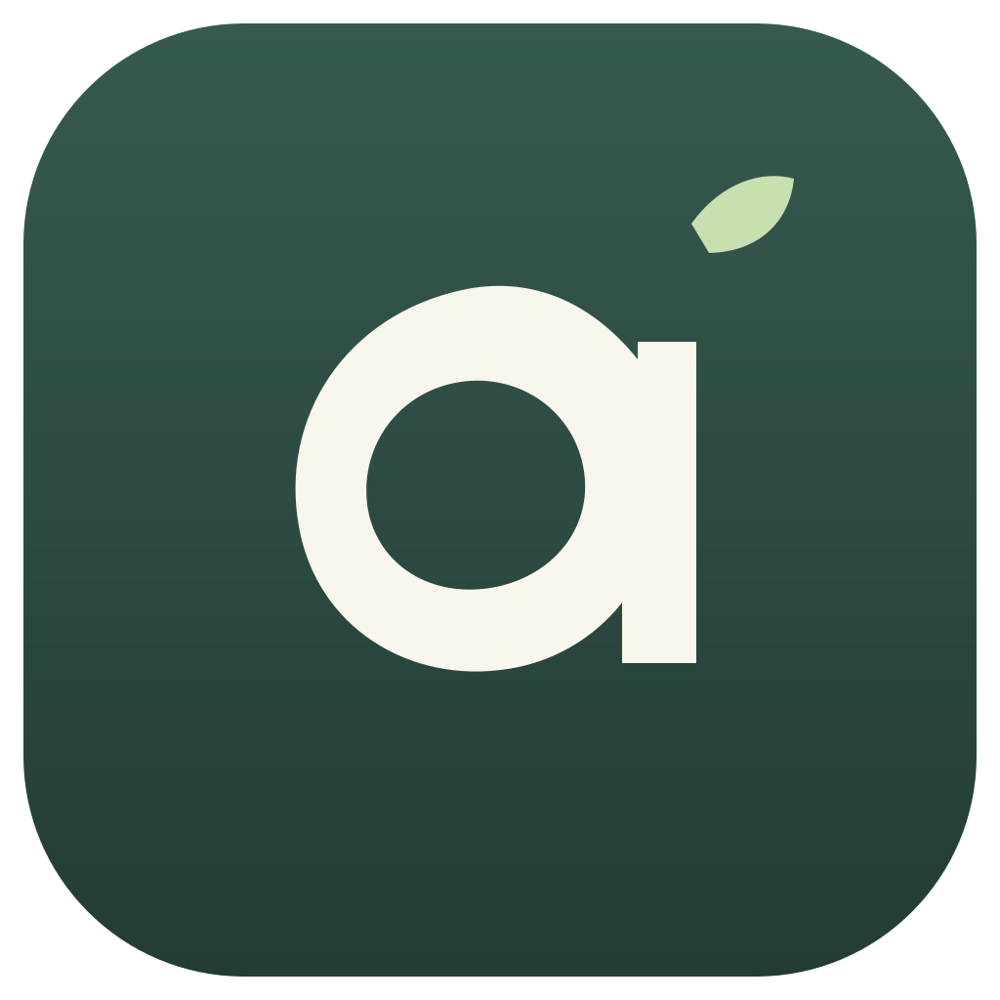

# Aplos Mail

An original macOS email app with a focused inbox, Later todos/bookmarks, rich drafts, Groq intelligence, and calendar commitments. Built from scratch after staged REA behavior investigation of an installed reference app. No reference code, artwork, branding, tokens, or mailbox contents are included.

## Run

Requires Node 22.12+ and macOS arm64 for the packaged desktop build.

```sh
npm install
npm run dev       # Browser preview: http://127.0.0.1:5173
npm run desktop   # Build and run Electron
npm test
npm run package   # release/mac-arm64/Aplos Mail.app
node scripts/launch.mjs # Launch packaged app with the ignored workspace .env
```

Original demo mail works immediately and stays local, including Send. Demo recipients use reserved `.example` addresses. Connect a Google account only when you want real mailbox access; Google Send and calendar changes then affect that account.

## AI configuration

Set `GROQ_API_KEY` in the launching process environment. Development loads an ignored project `.env` into that environment; packaged launches optionally load `~/.config/aplos-mail/.env`. Existing environment variables take precedence. See `.env.example`; never put real keys in source or a renderer build.

All AI requests, including speech transcription, go only to Groq. The default is Groq-hosted `openai/gpt-oss-120b`; override with `GROQ_MODEL`. Speech uses `whisper-large-v3-turbo`. A provider model name is not an OpenAI API integration. The key remains in the backend; email context is sent to Groq when invoking AI. Automatic classification runs for new Google mail; automatic calendar writes require enabling the calendar preference.

For Finder launches, put environment assignments in `~/.config/aplos-mail/.env`, restrict its permissions to your user (`chmod 600`), then reopen the app. The package never contains `.env`. Microphone recording requires macOS permission; the app explains permission failures. Voice recordings are capped at two minutes and transcribed through Groq; cancel discards the recording.

## Connect Gmail and Google Calendar

Create your own Google Cloud project, enable Gmail API and Google Calendar API, configure the OAuth consent screen/test users, and create a **Desktop app** OAuth client. Set `GOOGLE_CLIENT_ID` and `GOOGLE_CLIENT_SECRET` in the backend environment, restart, and choose Connect Google account in the desktop app. The flow uses a loopback redirect with state validation and PKCE. Refresh tokens are encrypted using Electron safeStorage. The browser preview intentionally cannot persist Google credentials.

The implemented adapter supports mailbox sync/search, label mutations, attachments, verified sending aliases and their Gmail signatures, MIME sending with reply headers and Bcc, calendar listing and event create/update/delete. Alias/signature access uses the Gmail settings scope; a missing grant falls back visibly to the primary address. Live Google verification is **not complete** without Aplos-owned OAuth configuration and an authorized test mailbox. Mocked adapter tests are not a substitute for that verification. Aplos never reuses the reference app’s credentials.

## Everyday controls

Use Home’s stack or split view, Done/Later, and `Z` to undo triage. Later separates Todos from Bookmarks, with due dates and reminders. Replies can target the sender or everyone; drafts autosave and support separate windows. Send waits for the configured undo delay. Provider errors preserve a recoverable draft.

Search supports `from:`, `to:`, `subject:`, `has:attachment`, `is:unread`, `is:bookmarked`, `in:`, `after:`, and `before:`. Ask cites messages and offers drafts for review; it never sends them. Press `?` for the shortcut guide. Appearance includes light/dark/system, zen counts, and three original Dock icons.

## Data and verification

Desktop state is stored under `~/Library/Application Support/Aplos Mail`; browser development uses a separate `Aplos Mail Preview` directory so simultaneous development cannot overwrite desktop mail (override with `APLOS_DATA_DIR`). It is a local SQLite database (`aplos.db`, written in small transactions); a `state.json` from an older build is imported on first launch and kept as `state.json.imported`. Builds from before this change cannot read the database, so run only the current build against the same data folder. OAuth credentials are a separate encrypted file. Mail/drafts are not encrypted at rest by this personal build. Export includes cached mail; keep exports private. Reset Demo preserves connected Google accounts.

`npm test` covers persistence, triage/undo, reminders, draft concurrency/recovery, delayed sends, validation, scoped AI proposals/citations/cancellation, OAuth PKCE/state, MIME, label mapping, encrypted credentials, calendar mutations, and desktop request/ownership policies. Live Groq was verified with synthetic text and audio. Browser and packaged-app acceptance results, exact remaining blockers, and REA limitations are recorded in `PROGRESS.md` and `TODO.md`.

This is a local personal build. It has no automatic distribution/update server or Developer ID notarization. Rebuild to update.

## Resume work

Read `SPEC.md`, `TODO.md`, `DECISIONS.md`, and `PROGRESS.md` first. Pick the next unchecked item, investigate one feature/module at a time, implement independently, verify, record evidence, check off only completed acceptance, and commit. Do not claim full reference parity while live integration or reference behavior remains unverified.
