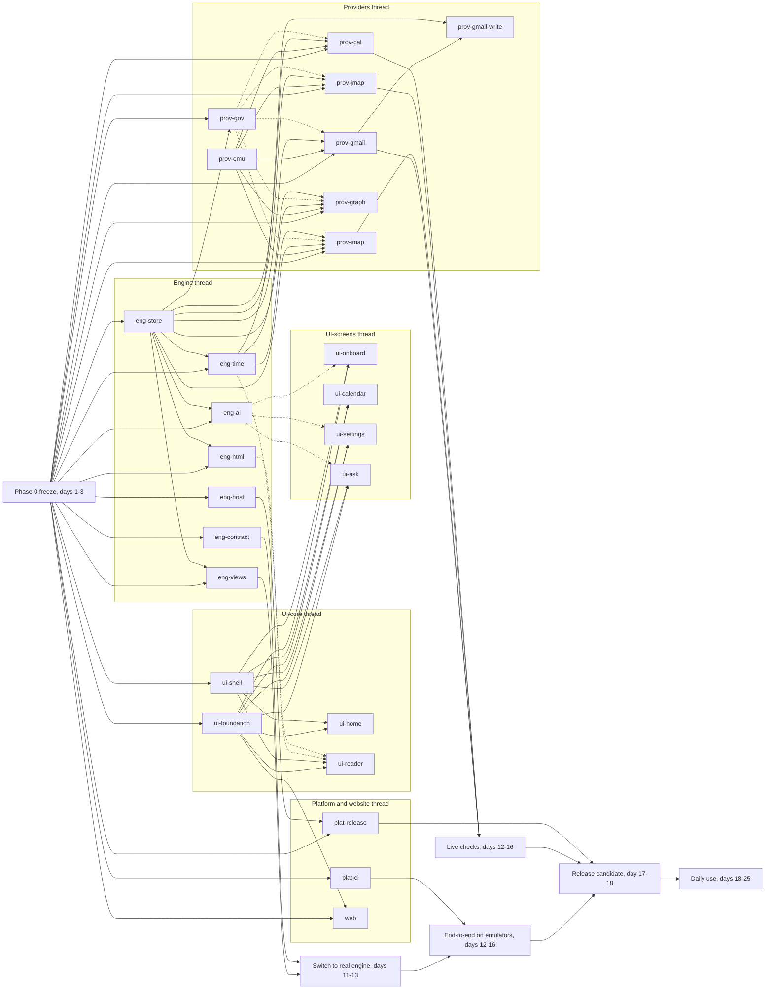

# Aplos revamp: the roadmap

Written 2026-10-27 on branch `revamp`, and rewritten the same day after your answers. This is a plan. Nothing in it is built yet, and nothing goes to main until you merge it.

Read down to "Reference". The rest is for the coding threads.

## In plain English

Today Aplos cannot finish a real Gmail sync, keeps your whole mailbox in memory, stops when you close the window, and still resembles Avec. The revamp rebuilds the engine, the mail connections and every screen at once, and ships them as one redesigned version. There is no separate quick Gmail fix. That fix is part of the rebuild.

First, for two or three days, one thread writes the shared rules: the folder layout, every command the screens can send to the engine, the database layout and the design tokens. Then about 25 small lanes of work run at once, each in its own folders. Then the pieces are joined and checked on practice servers, test accounts and your mail. Last, you use Aplos daily and the threads fix what you find.

Six threads run the lanes. One of them, the Integrator, merges everything and sends you one short summary a day. Expect a daily-use build in about two and a half weeks and a finished version in about three and a half. Nothing costs money.

## What the new Aplos will be

- Gmail shows your inbox in seconds and fills in the rest quietly, inside Google's limits. When Google refuses, Aplos waits and logs Google's reason.
- Gmail asks for a one-click reconnect each week, because the Google project stays in Testing mode. Aplos warns you a day ahead and loses nothing.
- iCloud and Fastmail get new mail within seconds. Calendars sync only what changed. Outlook works once you register a free Microsoft app.
- Mail lives in a database on your Mac that opens in milliseconds at 100,000 messages.
- Closing the window leaves Aplos in the menu bar, so mail, reminders and scheduled sends keep working.
- Each email shows in a sealed frame that can't track you.
- Background AI runs only after you agree. Groq stays the default.
- The look follows the revised mockups: quiet gray and white, roomy type, ink blue for the main action, a serif for AI text, no sky and no stripe, and a much simpler reader, reply and compose.

## The plan in days

Day 1 is the day you say go. If that is 28 October, day 18 is 14 November.

| Phase | Days | What happens | What you see |
|---|---|---|---|
| 0. Freeze the shared rules | 1-3 | One thread writes the rules. Three reviewers try to break them first. | A short "frozen" note |
| 1. Wide fan-out | 4-13 | About 25 lanes build at once on demo mail and practice servers | Main screens on demo mail around day 9 |
| 2. Join and check | 11-18 | Screens switch to the real engine; live checks on test accounts, then your mail | The new Aplos on your mail around day 15 |
| 3. Daily use | 18-25 | You use it as your only mail app; fixes every day or two | Done when a week passes with nothing blocking |

The longest chain runs through Gmail. The database write path is ready around day 6, Gmail passes on the practice server around day 11, and live checks run on days 12 to 15. The screens meet it at the release candidate around day 17. A mistake in the shared rules, a Gmail surprise or slow joining could stretch this to about five weeks.

## Decisions already made

- No 0.2.4. Pacing, subjects first, text on open, a stop on `quotaExceeded` and no retries are built into the rebuild.
- The website and privacy page live on aplos.email (`apps/web`, Vercel).
- The Google project stays in Testing mode: up to 100 listed test users and a reconnect every 7 days, made smooth.
- Nothing that costs money: no Google verification, no CASA, no paid services, no new domains. Opening Gmail to strangers is for later, if ever.
- Keep the Gmail filter permission.
- One repo, no releases repo. You get local or private draft builds. Going public later is your call, after a secret and history scan and a LICENSE file.
- Automatic live checks use throwaway test accounts only.
- Ink blue and a serif for AI text, inside the revised look.

## Decisions for you

Silence means the default.

1. **How many threads?** Default six: Engine, Providers, UI-core, UI-screens, Platform and website, Integrator. Five makes the Engine thread also judge every merge. Four, with one UI thread, adds about four days.
2. **How do you review?** Default once per phase, about behaviour, never code: a day-3 note, demo screens on day 9, an hour on real mail around day 15, then daily use. Per-lane review adds about 25 reviews.
3. **The weekly Gmail reconnect.** Default a quiet line in the sidebar a day before it expires, then one click. Options: add a Mac notification, or say nothing until it expires.
4. **Where do live Gmail checks run?** Default on this Mac at set times, so no Google token sits on GitHub. Nightly on GitHub needs you to refresh a token there weekly.
5. **Going public.** Default: the threads prepare the scan, notices and a draft LICENSE (GPL-3.0 app, MIT contract) during phase 3, and you decide later.

## What you need to do

All free.

- [ ] Day 1: say go; answer the decisions or keep the defaults.
- [ ] Day 1: finish the Home ordering discussion in the mockups thread, so its DESIGN-CHANGES list can be folded into DESIGN.md before the UI threads start.
- [ ] Day 1: create one or two throwaway Gmail accounts and add them to the Google project's test users. Confirm the 6,000 units a minute limit in the Cloud console.
- [ ] Days 1-3: a separate free Groq key for tests, a free Microsoft Entra app, and a check of Vercel's production branch. Optional: a Fastmail OAuth client and an iCloud app-specific password.
- [ ] Days 3, 9 and 15: the phase reviews.
- [ ] Days 14-16: about an hour of live checks on your own Gmail, including one send to yourself.
- [ ] Every 7 days: reconnect Gmail for you and the test accounts, about two minutes.
- [ ] From day 18: use it daily and report what bothers you.
- [ ] When happy: merge `revamp` and publish. Later, if you like: make the repo public.

Agents never merge to main, publish, send external mail, change repository visibility or rotate a credential.

## Top risks

- Wrong shared rules would force rework everywhere. Three reviewers attack them before the freeze, and later changes only add.
- Joining 25 lanes surfaces bugs. The real engine runs the stand-in engine's tests from day 4, and the switch happens on day 11.
- One Gmail test account allows 6,000 units a minute, and its token expires weekly. Practice servers carry most testing, and live runs follow your reconnect.
- Your review time is scarce, so reviews are per phase.

---

# Reference

Everything below is reference. You don't need to read it.

This roadmap schedules the work. The binding decisions live in `plans/ARCHITECTURE.md` (ARCH) and `plans/DESIGN.md` (DESIGN, with `mockups/DESIGN-CHANGES.md` revision 2 folded in before the UI threads start). The detail lives in plans 10, 20, 30 and 40. Their milestone names (E0-E8, PV0-PV11, U0-U9, Q0-Q8) are kept as citations. This roadmap re-cuts them into lanes. Section 10 lists the edits plans 10-40 need to match it.

**Names.** A *lane* is a unit of work with exclusive file ownership and one Claude Code workflow (or a short series of them). A *thread* is a long-lived T3 Code thread that runs several lanes in parallel. Day 1 is the owner's "go". Days are calendar days, because agents work around the clock and the owner's reviews are the human clock.

## 1. Phase 0: what gets frozen, in what order

Phase 0 freezes exactly the things that every lane reads and no lane may change alone. After the freeze, every lane can code against them with exclusive file ownership. Target two days, plan for three. The Engine thread leads, the Integrator signs off, and the other threads prepare in their own worktrees on new files only.

### 1.1 The restructure chain (day 1, serial, about one day)

Nothing else touches existing files while this runs. Each step is its own commit, merged by merge commit and listed in `.git-blame-ignore-revs` where mechanical.

| Step | Commit | Owner | Source |
|---|---|---|---|
| 0 | NOTICE in `plans/STATUS.md`: restructure started | Engine | |
| 1 | Rename and imports: `apps/desktop/src/engine` to `packages/engine/src`, with today's engine files under `packages/engine/src/legacy/`; the shared files to `packages/contract/src/legacy/`; today's renderer to `apps/desktop/src/renderer/legacy/`; re-export stubs where needed; workspaces, tsconfig paths, Vite alias, esbuild bundling `@aplos/*`; recursive portability test; `npm run package` and `verify-release.mjs` pass | Engine | Plan 10 E1 item 1 and section 3, amended |
| 2 | Prettier format commit over the moved tree, proved by identical minified output | Platform prepares, lands in the slot | Plan 40 Q1a |
| 3 | Split `apps/desktop/src/main/electron.ts` into owned modules: `windows.ts`, `lifecycle.ts`, `protocol.ts`, `menu-bar.ts`, `native-methods.ts`, `security.ts`, `updater.ts`, `engine-host.ts`. Code moves only. | Engine | Plan 10 section 3 and E1 |
| 4 | ESLint flat config, bulk suppressions, import boundaries, pre-commit hook, `static` job | Platform prepares, lands in the slot | Plan 40 Q1b |

The legacy folders keep building and keep their tests green. They are read-only reference until Phase 2 deletes them. There is no typed-client codemod over today's 53 `invoke(` sites and no legacy bridge, because no release ships today's screens on the new engine (section 10 lists the plan edits).

### 1.2 The frozen artifacts (days 2-3, parallel on new files)

| # | Artifact | Path | Written by | Reviewed by |
|---|---|---|---|---|
| F1 | Contract v1: every method name with zod input and output schemas, all frames (`state`, `window`, `progress`, `reset`, host channel) with `{dbEpoch, seq}` tokens and receipts, error types, the classified-error record, the status vocabulary including `paused(until, reason)`, `backfilling(n of m)` and the new `reconnectBy` time, the `Setup/status` shape, the Thread row with `partial`, `Mail/frame`, capability flags, the `Settings` schema with its `ui` object and per-feature AI provider and model, the logger event catalog | `packages/contract/src/**` | Engine | All three reviewers |
| F2 | Generated allowlists and the typed client `api.*`; the registry drives `preload.ts`, `engine-host.ts` and `server.ts` | `packages/contract/generated/**`, `src/client/**` | Engine | Platform |
| F3 | Ports: `ProviderAdapter` with `CalendarAdapter` and `findSent`, `GovernorPort`, `AccountActorHost`, `SendPort` with `NotSentError`, `DraftSyncPort`, `ProviderPort.openThread`, `Clock`, deadline-source registration, `KeyProvider`, `MailHtml`, `Logger`, `StorePort`, `bucketFor` | `packages/engine/src/ports.ts` | Engine, from Providers' proposal for the provider ports | Providers |
| F4 | Database: migration framework, `mail.db` schema 0001 (ARCH 3.2 plus plan 20's review items: recurrence id on `events`, `message_folders` keyed for IMAP placements, `sync_state`, `governor_state`, the account's token-grant time), the `store.commit` signature and a minimal working commit that writes `changes` and bumps `seq` | `packages/engine/src/store/migrations/0001*`, `store/port.ts` | Engine | Providers |
| F5 | Method dispatch table mapping every contract method to one module file (`methods/<area>.ts`), each a stub that throws `NotImplemented`, so lanes fill their own file and never edit the shared table | `packages/engine/src/methods/index.ts` | Engine | Integrator |
| F6 | Stand-in engine answering every method on the `demo` and `empty` scenarios, the `Fixture/control` signatures, and the conformance suite layout. Lane `eng-contract` fills in the other scenarios during Phase 1 | `packages/contract-fixture/**`, `packages/contract/tests/conformance/**` | Engine | UI-core |
| F7 | Logger and redacting log sink at final paths | `packages/engine/src/diag/log.ts`, `apps/desktop/src/host/logsink.ts` | Engine | Platform |
| F8 | `APLOS_TEST=1` and `APLOS_DATA_DIR` honoured in main (isolated data, no single-instance lock, no Dock or menu-bar item, windows created hidden) and the pinned Playwright base | `main/lifecycle.ts`, `tests/e2e/playwright.config.ts` | Engine, Platform | Integrator |
| F9 | Design tokens from the revised DESIGN.md (`tokens.json`, generator, `tokens.css`, `motion.ts`, contrast pairs), the design lint rules, the `aplos-design` skill v1, the component list with frozen props, the `CommandRegistry` interface, and the renderer data-hook signatures (`useView`, `useRow`, `api`, receipts) | `apps/desktop/src/renderer/{ui,commands,data}/**` (interfaces), `scripts/design/**`, `tools/lint/design/**`, `.claude/skills/aplos-design/**` | UI-core | UI-screens |
| F10 | Ownership map, path-ownership CI check, `plans/STATUS.md` | `plans/OWNERS.md`, `scripts/audit/owners-check.mjs` | Integrator, Platform | Everyone |

### 1.3 The freeze review (day 3, half a day)

Three adversarial reviewers, each a fresh agent given the artifacts but not the authors' reasoning, try to find what cannot be expressed:

- The UI reviewer walks every mockup screen and DESIGN section 5 and 7 and lists each behaviour the contract or data hooks cannot express. It also checks plan 30's twelve asks (plan 10 section 4.1 table).
- The Providers reviewer runs Gmail, IMAP, JMAP, Graph and CalDAV through `ProviderAdapter`, `GovernorPort` and schema 0001 on paper, including the weekly reconnect and the lease.
- The security and platform reviewer checks the registry tags and scopes, the transports, `Mail/frame`, the log catalog against ARCH 11 and 12, and the 400,000-byte engine budget.

The Engine thread fixes every gap. The Integrator tags `contract-v1` on `revamp` and posts FROZEN in STATUS.md. After that, changes are additive within `v:1`, proposed with CONTRACT-CHANGE-PROPOSED, and made only by lane `eng-contract`.

### 1.4 What the other threads do during Phase 0

| Thread | Phase 0 work |
|---|---|
| Providers | Propose `ProviderAdapter`, the status vocabulary and the reconnect fields by the morning of day 2; review schema 0001; build the Gmail emulator in `packages/emulators/gmail` until it reproduces 0.2.3's failure; write each lane's test plan |
| UI-core | F9, in its own worktree, merged after step 4 |
| UI-screens | Map each mockup screen to its DESIGN section and the contract methods it needs, and send the gaps to the UI reviewer; plan PR #21's absorption; draft harness scenarios |
| Platform and website | Prepare Q1a and Q1b for their slots; CI slots (`check:tokens`, `check:contrast`, `check:identity`, `test:visual`, `test:perf`); the owners check; after step 2, start the website in `apps/web` |
| Integrator | STATUS.md, OWNERS.md, git identity checks, the freeze checklist, the three reviewers, the merge procedure |

> **What this means:** For two or three days one thread restructures the code and writes the shared rules while everyone else prepares. Three reviewers try to break the rules before they freeze, because a mistake there costs the most later.

## 2. The lanes

Each lane owns its paths exclusively. A pull request that touches a path outside its lane fails the owners check unless the owning lane approved it. "Needs" lists only real dependencies after the freeze. Before a dependency lands, the lane codes against the frozen port with a stub or the stand-in engine.

### 2.1 Engine thread

| Lane | Owns | Implements | Needs | Days |
|---|---|---|---|---|
| `eng-contract` | `packages/contract/**`, `packages/contract-fixture/**`, `packages/engine/src/{runtime/**,methods/index.ts,methods/session.ts,methods/settings.ts}`, `host/transports/port.ts`, `main/engine-host.ts`, `main/server.ts`, generated part of `preload.ts` | Plan 10 section 4.1 and E1 items 3, 6, 7; the transport half of E3 (direct `MessagePort`, main out of the data path); ARCH 9 | Phase 0 lead | 1-3, then 4-10 |
| `eng-store` | `packages/engine/src/store/**` (incl. `store/import/**`), `packages/engine/bench/**` | Plan 10 E2 deliverables 1-11 and "The import"; ARCH 3 | F4 | 4-10 (real commit, ids, change log by 6; bodies, search, retention by 9; importer by 10) |
| `eng-views` | `packages/engine/src/views/**`, `methods/{view,thread,operation}.ts` | Plan 10 E3 (view specs, window engine, holds, receipts, `Thread/act`, `Operation/undo`); ARCH 9.2 | Real store from day 6 | 4-11 (conformance green on the real engine by 11) |
| `eng-time` | `packages/engine/src/{outbox,clock}/**`, `methods/{submission,draft,outbox,later,reminder,notification}.ts` | Plan 10 E6 (submissions, undo and send later, overdue, drafts, one timer loop, notification outbox); ARCH 7 | Real store | 4-10 |
| `eng-ai` | `packages/engine/src/ai/**`, `methods/{ai,ask,setup,demo,consent,queue}.ts`, `apps/desktop/src/host/ai/**` (today's `main/{groq,llm,ollama,anthropic,ai-keys}.ts` move here) | Plan 10 E5 (jobs, AI governor and budget, consent, heuristic Home, `Setup/*`, `Demo/*`); ARCH 8 | Real store; `eng-views` for Home ranks | 4-11 |
| `eng-html` | `packages/mail-html/**`, `host/protocol/**`, `host/proxy/**`, `main/protocol.ts`, `methods/mail.ts` | Plan 10 E4 (sanitizer, `Mail/frame`, tokens, image proxy); ARCH 10 | Bodies from `eng-store` | 4-10 |
| `eng-host` | `main/{lifecycle,menu-bar,windows,native-methods}.ts`, `host/{lifecycle,power,lock,crash}.ts`, `packages/engine/src/selftest.ts`, `host/transports/{socket,http}.ts`, `host/{mcp,cli}/**`, `packages/engine/src/diag/bundle/**`, `methods/{diagnostics,listener,clients}.ts` | Plan 10 E1 items 4-5 (resident mode, lock, wake, parked, self-test) and E7 (socket, loopback HTTP, clients and scopes, OpenAPI, MCP, diagnostics); ARCH 2, 11, 12.3 | none beyond freeze | 4-12 (resident by 7, doorway by 12) |

### 2.2 Providers thread

| Lane | Owns | Implements | Needs | Days |
|---|---|---|---|---|
| `prov-emu` | `packages/emulators/**`, `apps/desktop/scripts/live/**`, `scripts/smoke/probes/**` | Plan 20 PV1a, PV1b, sections 5.4-5.5 (live harness, experiments register) | none | 1-9 (Gmail by 4, IMAP by 5, JMAP and DAV by 6, Graph by 7, live runner by 9) |
| `prov-gov` | `packages/engine/src/sync/**`, `host/providers/shared/**`, `host/providers/oauth/**` (today's `main/oauth-config.ts`), `methods/{account,sync}.ts` | Plan 20 PV2 and the lease; the free parts of PV5 (client resolution for source builds, scope manifest and its test, granted-scope handling); the weekly-reconnect engine side (grant time, `reconnectBy`, `login_hint`, reconnect without resync, queued local changes kept) | Real store | 4-9 (shared HTTP client and classifier by 5, governor by 7, accounts by 9) |
| `prov-gmail` | `host/providers/google/{client,sync,history,bodies,search,workflow,classify}.ts` | Plan 20 PV3 with every PV0 deliverable and acceptance item folded in (pacing, four error classes, `quotaExceeded` stop, no retries, metadata-first window, lazy bodies, cheap history rule, search on Enter, granted scopes, exact-reason logging, EX1-EX3) | Gmail emulator; real store; real governor from day 7 (stub before) | 4-12 (emulator gate by 11) |
| `prov-gmail-write` | `host/providers/google/{send,drafts,filters,unsubscribe}.ts`, `methods/unsubscribe.ts` | Plan 20 PV4 | `prov-gmail` client by 6; `eng-time` submissions and drafts | 6-12 |
| `prov-imap` | `host/providers/imap/**` (today's `main/imap*.ts`) | Plan 20 PV6 with SMTP and IMAP drafts | IMAP emulator; real store; `eng-time` | 5-12 |
| `prov-jmap` | `host/providers/jmap/**` | Plan 20 PV7 | JMAP emulator | 6-11 |
| `prov-cal` | `packages/engine/src/calendar/**`, `host/providers/caldav/**`, `host/providers/{google,microsoft}/calendar*.ts`, `methods/event.ts` | Plan 20 PV8 and PV9 | DAV emulator; Google calendar emulator | 5-13 |
| `prov-graph` | `host/providers/microsoft/**` except calendar files | Plan 20 PV10; live once the owner's free Entra app exists | Graph emulator; `eng-time` | 7-13 |

### 2.3 UI-core thread

| Lane | Owns | Implements | Needs | Days |
|---|---|---|---|---|
| `ui-foundation` | `renderer/ui/**`, `renderer/commands/**`, `scripts/design/**`, `tools/lint/design/**`, `.claude/skills/aplos-design/**`, `tests/visual/**`, `tests/perf/**`, fonts | Plan 30 U1 and U3 (tokens, lint, skill, registry, harness with the hover-never-shifts check, components); U0's checks (banned strings, identity, AGENTS.md rule, retiring "match the reference" decisions); DESIGN 4, 6, 12 as revised | Revised DESIGN.md | 1-3 (F9), then 4-9 |
| `ui-shell` | `renderer/{data,shell,motion}/**`, `renderer/App.tsx`, `renderer/main.tsx`, `renderer/bridge.ts` | Plan 30 U2 and section 4.1 (data layer), U4 (motion as revised), U5's shell, sidebar, pane header, status slot, toasts and trays, and WP5.6 (the switch to the real engine, run in Phase 2); the reconnect note in the status slot | F6, F9; `eng-views` for the switch | 4-11 |
| `ui-home` | `renderer/screens/{home,later,lists,done}/**` | Plan 30 U5's screens (Home, Later, All mail, Drafts, Sent, Trash, Spam, labels, the new Done place, one-by-one, empty states); DESIGN 7.2-7.4, 7.14 | `ui-foundation` components; `ui-shell` hooks | 5-12 |
| `ui-reader` | `renderer/screens/{reader,compose}/**`, `renderer/mailframe/**` | Plan 30 U6 and section 4.4 (reader, mail frame on `srcdoc` against the stand-in engine until `eng-html` lands, inline reply, compose, outbox and undo tray); DESIGN 7.5-7.6 | `eng-html` for the real frame; `eng-time` for real send states | 5-13 |

### 2.4 UI-screens thread

| Lane | Owns | Implements | Needs | Days |
|---|---|---|---|---|
| `ui-onboard` | `renderer/onboarding/**`, `main/windows/onboarding.ts` | Plan 30 U8 (onboarding window, first-sync screen, consent, demo on request, PR #21's screens absorbed by path, Appendix C findings); the reconnect sheet; DESIGN 7.11-7.12 as revised | `eng-ai` `Setup/*` for Phase 2; `prov-gov` status facts | 5-12 |
| `ui-calendar` | `renderer/screens/calendar/**` | Plan 30 U7's Calendar; DESIGN 7.8 | `prov-cal` fields (frozen in F1) | 6-12 |
| `ui-settings` | `renderer/screens/settings/**` | Plan 30 U7's Settings (accounts with reconnect, AI providers and a model per feature, appearance, keyboard, tools on this Mac, diagnostics, retention); DESIGN 7.10 | `eng-host` listener methods; `eng-ai` provider table | 6-12 |
| `ui-ask` | `renderer/screens/{ask,today,palette,search}/**` | Plan 30 U7's command palette, search, Ask dock and Today; DESIGN 7.7, 7.9 | `eng-ai` Ask frames | 6-13 |

### 2.5 Platform and website thread

| Lane | Owns | Implements | Needs | Days |
|---|---|---|---|---|
| `plat-ci` | `.github/workflows/ci.yml`, `tools/lint/**` except `design/`, `tests/e2e/**`, `budgets.json`, `scripts/audit/**`, `scripts/smoke/**` except probes | Plan 40 Q1 (Phase 0 slots), Q3 (CI, emulator E2E, budget register), Q4 (AI eval replay, live smoke runner on throwaway accounts) | none | 1-3, then 4-12 |
| `plat-release` | `apps/desktop/build/**` except the DMG background, `main/{security,updater}.ts`, `.github/workflows/release.yml`, `scripts/{release,verify-release,release-build}.mjs`, `RELEASING.md`, `THIRD_PARTY_NOTICES*`, `LICENSE` draft, `docs/release-checklist.md` | Plan 40 Q0 without the releases repo, Q2 (fuses, permission handler, CSP stages, unfused E2E build), Q7a and Q7b (draft releases in this repo, verifier, beta channel, Keychain evidence), Q6 without CASA or the paid name search, Q8's release gate | `eng-host` self-test; `eng-html` for the CSP stage 2 | 4-14, OSS prep in Phase 3 |
| `web` | `apps/web/**`, `apps/desktop/build/dmg-background.html` | Plan 40 Q5A and Q5B; remove the stripe and fix untrue claims only; the full site redesign waits for the new logo (owner, 2026-10-27); the privacy page on aplos.email with Google's Limited Use sentence, what is stored, what leaves the Mac, no telemetry and how to delete data; Gmail described as available to invited testers | F9 tokens | 2-8 |

### 2.6 After Phase 1

| Work | Implements | Who | Days |
|---|---|---|---|
| Switch to the real engine | Plan 30 WP5.6 | `ui-shell` with the Integrator | 11-13 |
| End-to-end journeys on emulators | Plan 40 Q3 emulator E2E | `plat-ci`, Integrator | 12-16 |
| Live checks | Plan 20 section 5.4; PV3, PV6, PV7, PV9 live gates | Lanes run tier R on test accounts; the owner runs checks on their own accounts | 12-16 |
| Delete legacy folders and old provider files | Plan 10 E8 item 4, plan 20 section 3.1 | Integrator with each owning lane | 14-17 |
| Hardening and soak | Plan 10 E8, plan 20 PV11 (soak runs in the background during Phase 3) | Engine, Providers | 15-25 |
| Accessibility, performance, release candidate | Plan 30 U9, plan 40 Q8 | `ui-foundation`, `plat-release`, Integrator | 15-18 |

> **What this means:** 26 lanes, each owning its own folders, built against the frozen rules. Most finish within about 10 days. The Gmail lane and the reader take longest.

## 3. Dependency graph

Solid arrows are hard dependencies. Dashed arrows mean the lane starts on a stub or the stand-in engine and swaps in the real piece when it lands.

## 4. Critical path and day plan

### 4.1 The critical path

1. **Gmail chain, the longest.** Freeze (day 3), then `eng-store`'s real `store.commit`, ids and change log (day 6), then `prov-gmail` on the real store and, from day 7, the real governor, to the emulator gate (day 11). Then scheduled live runs on the throwaway accounts (days 12-14) and the owner's hand-run check on their own Gmail (days 14-15). Fixes and the release candidate follow (days 17-18), then a week of daily use (days 18-25).
2. **Screens chain, close behind.** Freeze with F9 (day 3), then components and data hooks (days 4-8), then screens on the stand-in engine (days 5-13). `eng-views` passes the conformance suite on the real engine (day 11), the switch follows (days 11-13), then end-to-end on emulators (days 12-15) and the owner's look check on real mail (day 15). It meets the Gmail chain at the release candidate.
3. **Near-critical.** `ui-reader` (needs `eng-html` and `eng-time`), `prov-cal` (largest provider scope after Gmail), and `prov-imap` (iCloud live pass).

### 4.2 Range

| Case | Daily-use build | Finished version | Assumes |
|---|---|---|---|
| Best | day 15 | day 22 | No contract gaps, Gmail live passes first time, reviews same day |
| Likely | day 17-18 | day 25 | One contract addition, one Gmail live fix, a day of review wait per phase |
| Slow | day 25 | day 35 | A contract change that breaks lanes, a second cause behind Gmail's refusals, a design rework, agent rate limits |

### 4.3 Owner touchpoints by day

| Day | Event |
|---|---|
| 1 | Go; decisions; design questions; test accounts and test users; Groq key; Entra app; Vercel check; 6,000-unit check |
| 3 | Freeze note (5 lines, optional read) |
| 9-10 | Look review: main screens on demo mail in the browser preview, about 30 minutes |
| 7, 14, 21 | Weekly Gmail reconnect for you and the test accounts |
| 14-16 | Live checks by hand, about an hour, from the Integrator's checklist: your own Gmail, one real send to yourself with a mid-send kill, iCloud and Fastmail if you have them, a real onboarding, keys with focus inside an email, and a one-minute lid close |
| 17-18 | Install the release candidate; start daily use |
| 18-25 | Daily use; a quick VoiceOver and input-method check; one weekly reconnect happens inside this week, which tests the reconnect flow for real |
| 25 | Sign off; merge `revamp` into main and publish when you choose |

## 5. Threads

### 5.1 Mapping

| Thread | Lanes | Peak concurrent workflows | Models |
|---|---|---|---|
| Engine | `eng-contract`, `eng-store`, `eng-views`, `eng-time`, `eng-ai`, `eng-html`, `eng-host` | 7 | Opus for the contract, store, views, outbox, sanitizer, proxy and doorway security; Sonnet for scoped work; cheap models for mechanical moves |
| Providers | `prov-emu`, `prov-gov`, `prov-gmail`, `prov-gmail-write`, `prov-imap`, `prov-jmap`, `prov-cal`, `prov-graph` | 8 (graph and gmail-write start later) | Opus for the governor, Gmail sync, lease and recurrence; Sonnet or strong open-weight models for emulators and well-specified adapters |
| UI-core | `ui-foundation`, `ui-shell`, `ui-home`, `ui-reader` | 4 | Claude only: Opus for the data layer, motion, Home, reader and mail frame; Sonnet for routine work |
| UI-screens | `ui-onboard`, `ui-calendar`, `ui-settings`, `ui-ask` | 4 | Claude only: Opus for onboarding and Calendar layout; Sonnet for Settings and routine screens |
| Platform and website | `plat-ci`, `plat-release`, `web` | 3 | Opus for hardening and release security; Claude for the website; cheap models for CI plumbing |
| Integrator | none; merges, the full suite, the conformance burn-down, Phase 2 lead, owner digests | 1 plus reviewers | Opus for judgement; Haiku for test runs and summaries |

### 5.2 Why six

- **Merge conflicts** depend on path ownership, not on thread count. The owners check makes cross-lane edits fail in CI, so more lanes do not mean more conflicts. Thread count matters for coordination. Each orchestrating thread keeps at most about eight workflows in view.
- **UI gets two threads** because it is the second-longest chain and Claude-only. One thread holds the shared UI foundation and the two hardest screens. The other holds four independent screens. With one UI thread, eight UI workflows would queue behind one orchestrator and the screens chain would become the longest by about four days.
- **The Integrator is separate** because merging about 50 small pull requests a day, running the full suite and guarding conformance is a full-time job. The Engine thread changes the contract, so it should not also judge every merge.
- **Owner load.** The owner reads one daily digest from the Integrator and four phase reviews, not six streams. Fewer threads would not cut that reading; more would raise merge-queue pressure on the Integrator.

## 6. Bottlenecks and what the plan does about them

| Bottleneck | Mitigation |
|---|---|
| Contract and schema freeze quality | Three adversarial reviewers from the consumers' side, the 4.1 checklist of UI asks, Providers walking every adapter through the ports, additive-only changes after the freeze, one owner (`eng-contract`) |
| Merge conflicts | Exclusive paths in `plans/OWNERS.md` enforced by `owners-check`; one shared dispatch table frozen with one file per lane; small PRs (one work package, ideally under 500 changed lines excluding generated files); lanes merge `revamp` into their branch before each PR; the Integrator merges continuously |
| Gmail quota for live tests | Emulators first: the Gmail emulator must reproduce 0.2.3's failure before anything is tested on it. Live runs are scheduled, read-only first, each under 3,000 units a minute, on one or two throwaway accounts (per-user quota, so a second account doubles the room). Runs follow the weekly reconnect. |
| Testing mode's 7-day tokens | Weekly reconnect ritual covers the owner and test accounts together; the live runner checks `reconnectBy` before starting and skips with a clear message |
| Owner review time | Per-phase reviews with checklists written ahead; plain-English summaries; the owner judges behaviour and feel, never code; agents verify everything a machine can |
| Integration bugs | The conformance suite runs against both the stand-in and the real engine from day 4, with a shrinking expected-fail list; the switch happens on day 11, not at the end; daily end-to-end on emulators from day 12; providers not ready by day 16 ship switched off rather than holding the release |
| Machine and CI limits | Many agents share one Mac. Lanes run targeted tests; only the Integrator runs the full suite. GitHub Actions runs on pushes to `revamp` only, Linux only, to stay within free minutes; macOS jobs run on demand. If the owner allows it, the Linux MacBook Air can serve as a free self-hosted runner. |
| Agent rate limits | Threads start the critical lanes first (`eng-store`, `prov-gmail`, `eng-views`, `ui-shell`, `ui-reader`) and stagger the rest |
| Design still moving | DESIGN-CHANGES is folded into DESIGN.md before UI threads launch; tokens live in one file; the mockups are the visual target |
| Token cost | Acceptable per the owner. Threads still avoid overlapping agents and do not fan out work that is not parallel. |

## 7. Branch and merge strategy

- `main` holds released code only. Nothing goes to main until the owner merges `revamp` for the redesigned release. Agents never merge into main.
- `revamp` is the integration branch. Lanes open pull requests into it. Only the Integrator merges them, after typecheck, tests, `npm run check`, the owners check and the conformance run pass. The one exception is STATUS.md entries, which any thread pushes directly (`git pull --no-rebase` first, never force).
- Lane branches are `rv/<lane>/<slug>`, for example `rv/eng-store/commit`, `rv/prov-gmail/history`, `rv/ui-home/triage`. Each runs in its own git worktree. Thread coordination branches are `rv/thread/<name>`. No branch name is ever a folder of another, so there is never a branch named exactly `rv/<lane>` or `rv/thread`. `rv/ui/mockups` stays as the design thread's branch.
- At launch, the `mockups/` folder from `rv/ui/mockups` is merged into `revamp` as read-only visual reference.
- Merge style: Phase 0's mechanical commits merge by merge commit and go into `.git-blame-ignore-revs`. Everything else squashes, naming the lane and work package. Long-lived branches take `revamp` by merge, never rebase. Nobody force-pushes a shared branch.
- Evidence (test output, numbers, headless screenshots in both themes) goes in the PR with `gh pr create --attach`, never committed. Review is batched per lane milestone, and nobody re-triggers Cubic after every fix.
- Contract changes go only through `eng-contract`, labelled `contract-change`, additive within `v:1`.
- Builds: local packaged builds, or `v0.3.0-beta.N` draft releases in this private repo on the owner's go-ahead. The owner installs them by hand. The stable redesigned release is proposed as 0.3.0, tagged from main after the owner merges.
- Commits are authored as Kainoa Newton <k@kainoa.me>. Threads flag any other `git config user.email` before committing. PR #21 is never merged; `ui-onboard` absorbs its screens by path and the owner closes it.

> **What this means:** Every lane works on its own branches and its own folders. One thread merges everything into `revamp`, so the shared branch stays green. Main changes once, when you choose.

## 8. Decisions

### 8.1 Answered by the owner on 2026-10-27

| Old # | Question | Answer |
|---|---|---|
| 1 | Ship 0.2.4 now? | No. The Gmail fix is built into the rebuild |
| 2 | Which domain? | aplos.email, already owned; `apps/web` on Vercel |
| 3 | Testing to Production? | Stay in Testing. 100 test users, weekly reconnect, made smooth |
| 4 | Google review and CASA? | No. Nothing that costs money. See 8.4 |
| 5 | Keep the Gmail filter permission? | Yes |
| 6 | Where do downloads come from? | This repo. No releases repo. Public later, the owner's call |
| 7 | Which mailboxes may automatic live checks use? | Throwaway test accounts only |
| 8 | How many threads? | Replaced by new decision N1 |
| 9 | One big release with betas? | Yes, one redesigned release, no 0.3.0/0.4.0 split |
| 10 | Ink blue and a serif for AI? | Yes, inside the revised look |
| 11 | Strangers download 0.2.4? | Moot |
| 12 | Register Microsoft now? | Yes, a free Entra app, personal and work accounts, no publisher verification |
| 43 | Ship U0's wording fixes early? | Moot, no interim release |
| 56 | When does the code go public? | When the redesigned version is ready, the owner's decision then |
| 59 | Professional name search? | No, it costs money. Later, if ever |

### 8.2 New decisions (defaults apply)

| # | Question | Default |
|---|---|---|
| N1 | How many threads? | Six: Engine, Providers, UI-core, UI-screens, Platform and website, Integrator |
| N2 | How does the owner review? | Per phase, behaviour only, with checklists, plus one daily digest |
| N3 | The weekly Gmail reconnect | Status-area line a day ahead, one-click reconnect with `login_hint`, no resync, local changes kept |
| N4 | Where do live Gmail checks run? | On this Mac at scheduled times; no Google tokens on GitHub |
| N5 | Going public | Threads prepare the scan, history check, notices and LICENSE draft in Phase 3; the owner decides later |

The owner answered the four mockup questions on 2026-10-27: drop the app icon from the app (a new logo comes later), redesign the website only after the new logo exists, call the design "Paper", and show account dots only when two or more accounts are connected. Home's ordering rules are still being discussed in the mockups thread.

### 8.3 Still open with defaults (from the plans)

| # | Question | Default | Source |
|---|---|---|---|
| 13 | First sync size | Newest 500 Inbox conversations and 30 days of Sent, then quiet backfill to 90 days | ARCH D4 |
| 14 | Menu-bar residency | Menu bar only when the last window closes; start hidden at login; ⌘Q quits | ARCH D5; plan 10 D1 |
| 15 | Warn on ⌘Q with pending work | Yes, naming how many | Plan 10 D2 |
| 16 | Reminder due while asleep | Fire on wake, "was due 9:00" | Plan 10 D3 |
| 17 | Scheduled send due while off | Ask after 5 minutes' grace | ARCH D9 |
| 18 | Message text kept on the Mac | 90 days plus opened, starred or unread, capped at 2 GB | ARCH D6 |
| 19 | Encrypt beyond FileVault | No | ARCH D7 |
| 20 | Remote images | Blocked until allowed per message or sender | ARCH D8 |
| 21 | Old `aplos.db` after import | Kept until the redesigned release is stable, then "Remove old copy" offered | Plan 10 D4 |
| 22 | Damaged database | Stop, keep the file, offer Export, Restore or Rebuild | Plan 10 D6 |
| 23 | Local doorway on by default | Off until "Allow tools on this Mac" | Plan 10 D5 |
| 24 | Ask 0.2.x users for AI consent again | Yes, once | Plan 10 D7 |
| 25 | Free Gemini keys and mail | Never for mail until marked paid | Plan 10 D8 |
| 26 | Background AI per day | 150,000 tokens, adjustable | ARCH D13 |
| 27 | If engine work runs long, what waits | The doorway's MCP and CLI extras, then the AI queue's extras; never the sealed frame, outbox or views | Plan 10 D10, revised |
| 28 | Background helper after ⌘Q | Not now | ARCH D14 |
| 29 | Phone app | Later, as a remote for the Mac | ARCH D10 |
| 30 | Hosted push relay | Not now | ARCH D15 |
| 31 | Unsubscribe | One-click after you confirm, else email, else open the page | Plan 20 D5 |
| 32 | Repeating-event edits | "This event" and "all events" first | Plan 20 D6 |
| 33, 34 | Skypaper, cool sky neutrals | Superseded by the revised "quiet paper" direction (DESIGN-CHANGES) | DESIGN D1, D4 |
| 35 | Reader top | Sender, then the big summary, then one row of actions, then the message | DESIGN D5 as revised |
| 36 | Done on mail needing a reply | Leaves Home with a "Remind me if no reply" toast | DESIGN D6 |
| 37 | Where arrow keys triage | Home, the reader and one-by-one | DESIGN D7 |
| 38 | Key hints | Hidden until hover or ⌘, except Space; hover never moves anything | DESIGN D8 as revised |
| 39 | Ask dock on first run | Closed, then remembered | DESIGN D9 |
| 40 | ⌘K | A command palette; `/` for search | DESIGN D10 |
| 41 | Home focus letter height | Fixed | DESIGN D11 |
| 42 | Reader margin rail | Removed by the revision; single reading column | DESIGN D12 as revised |
| 44 | PR #21 | Absorb its screens; the owner closes it | Plan 30 D4 |
| 45 | Visual baselines | A small golden set plus same-machine comparison | Plan 30 D5 |
| 46 | Small undrawn surfaces | The UI threads may design them inside DESIGN; the owner reads the copy at the day-9 and day-15 reviews | Plan 30 D6 |
| 47 | Tap versus hold on R and A | Tap acts; hold adds dictation; 250 ms | Plan 30 D7 |
| 48 | How the owner tries builds | Browser preview on day 9, packaged builds from day 15 | Plan 30 D8, revised |
| 49 | Daily-use week before main | Yes | Plan 30 D9 |
| 50 | Onboarding look | Small separate window, no sky and no app icon (owner, 2026-10-27) | Plan 30 D10 as revised |
| 51 | Open Aplos after setup | On a clean finish only | Plan 30 D11 |
| 52 | Reformat in one commit | Yes, in Phase 0 | Plan 40 A |
| 53 | Licence | GPL-3.0 for the app and engine, MIT for `packages/contract`; `UNLICENSED` until the owner chooses | ARCH D12; plan 40 C |
| 54 | History when public | Decided at the time; this repo goes public as is after the scan, or after an in-place rewrite | Plan 40 D, revised |
| 55 | Contributor agreement | DCO sign-off | Plan 40 E |
| 57 | CI cost | Free minutes only: Linux on pushes to `revamp`, macOS on demand | Plan 40 H, revised |
| 58 | Published contact address | A free forwarding address on aplos.email, plus GitHub private reporting once public | Plan 40 I, revised |
| 60 | Drop unproven website claims | Yes | Plan 40 K |

### 8.4 Later, if ever

Opening Gmail to people outside the test-user list needs Google's restricted-scope review and a yearly CASA assessment, which costs money (the old calendar was removed from plan 40). It is off the active plan. Nothing in the build prevents it later, because the scope manifest, privacy page and no-telemetry rule stay in place. Until then the website says Gmail is available to invited testers, while iCloud, Fastmail and other IMAP accounts work for anyone who has the app.

## 9. All risks

| # | Risk | What the plan does about it |
|---|---|---|
| 1 | A frozen-contract mistake forces rework | Adversarial review before the freeze; additive changes only; one owner |
| 2 | Integration bugs at the switch | Shared conformance suite from day 4; switch on day 11; daily end-to-end on emulators |
| 3 | A second cause hides behind Gmail's 403 | Exact-reason logging from day 1 of `prov-gmail`; live acceptance on the owner's account |
| 4 | Live Gmail quota and weekly token expiry slow testing | Emulator first; scheduled live runs; two test accounts; runs follow the reconnect |
| 5 | The importer loses or duplicates local data | Reads `aplos.db` read-only; resumes after a kill; property tests; an owner-run rehearsal on a copy with a content-free report |
| 6 | Owner review becomes the bottleneck | Per-phase reviews, checklists, daily digest |
| 7 | One Mac cannot run 25 lanes' tests at once | Targeted tests per lane; full suite only by the Integrator; optional self-hosted Linux runner |
| 8 | Design changes arrive mid-build | Fold before launch; tokens in one file; screen lanes follow the mockups |
| 9 | Keys may not work with focus inside an email | A hand check on days 14-16 and a fallback that relays only scrolling keys |
| 10 | A provider lane runs late | It ships switched off; the release does not wait for Outlook or calendar extras |
| 11 | Going public exposes history or secrets | Secret scan of every branch and a history check before the owner decides |
| 12 | Old code lingers and confuses agents | Legacy code sits in `legacy/` folders from day 1 and is deleted in Phase 2 |

## 10. Changes the other plans need

A later pass aligns plans 10-40, ARCH and DESIGN to this roadmap. These are the edits.

**Plan 10 (engine).**
1. Remove E0's `hotfix/0.2.4-log` branch and main-path files; the logger and sink become Phase 0 artifact F7 at final paths.
2. Replace E1's freeze window with section 1 here: no step 0 merge from main (main does not change), legacy code moved into `legacy/` folders, `electron.ts` split in Phase 0, no typed-client codemod over today's 53 `invoke(` sites, `format-merge.mjs` dropped.
3. Collapse C0 and C1 into one freeze at the end of Phase 0 (day 3) with the three-reviewer gate; the stand-in engine answers every method at the freeze and gains its scenarios in Phase 1.
4. Delete the legacy bridge (section 4.2, `assembleLegacyState`, `legacyStoreAdapter`, the legacy op kind) and the `service.ts` split (WP1.2). E8's shim removal becomes "delete the legacy folders".
5. Merge E2a back into one store lane (`eng-store`), schema 0001 frozen in Phase 0; keep the importer.
6. Re-cut E1-E8 into lanes `eng-contract`, `eng-store`, `eng-views`, `eng-time`, `eng-ai`, `eng-html`, `eng-host`; weeks become days; 0.2.4, 0.3.0 and 0.4.0 become one redesigned release (proposed 0.3.0).
7. Decisions: D9 settled by design; D10 revised (the doorway's extras wait first, never the sealed frame); D11 replaced by N1.
8. Add the `reconnectBy` account fact to the contract and `Setup/status`; branch names to `rv/<lane>/<slug>`.

**Plan 20 (providers).**
1. Remove PV0 as a milestone and the whole `hotfix/0.2.4` train; move PV0's deliverables and its emulator acceptance items into PV3 (`prov-gmail`) and PV2 (`prov-gov`), and keep EX1 and EX2 in `prov-gmail`.
2. Remove PV5's verification and CASA track, brand verification, demo video and scope justifications; keep client resolution, the scope manifest and its test, and granted-scope handling in `prov-gov`.
3. Add the weekly-reconnect engine behaviour to `prov-gov` (grant time, `reconnectBy`, `login_hint`, no resync, queued changes kept) and live-runner checks for expiring tokens.
4. Re-cut PV1-PV10 into the eight `prov-*` lanes; PV11 moves to Phases 2-3; weeks become days.
5. Decision answers: 1 no review or CASA; 2 the owner registers a free Entra app; 3 throwaway accounts only, runs local by default (N4); 4 keep filters; 7 moot.
6. Drop the dependency on the legacy bridge; a provider not ready by day 16 ships switched off.
7. Section 5.4: Testing-mode expiry applies to test accounts; delete "the Production switch unblocks the harness". Section 6: drop Google-review risks, add weekly expiry. Section 7: drop the releases repository and CASA documents.

**Plan 30 (UI).**
1. Start from DESIGN.md with DESIGN-CHANGES folded in and the mockups as the visual target. Remove the sky, horizon, post edge, sky moments, `post` and `drain` motions and the margin rail from U3, U4, U5, U6 and U8.
2. Drop U0 as a milestone; move its banned-string test, identity check, AGENTS.md rule and DECISIONS retirement into `ui-foundation`; map the ten known defects to tests in the new screens.
3. Drop the `srcdoc` hotfix slice; `MailFrame` keeps its props and uses `srcdoc` on the stand-in engine until `eng-html` lands.
4. Re-cut U1-U8 into the eight `ui-*` lanes; U9 moves to Phases 2-3; WP5.6 runs on day 11-13; weeks become days.
5. Add F9 to Phase 0 (tokens, lint, skill v1, component props, `CommandRegistry`, data-hook signatures), the hover-never-shifts harness check, and the reconnect surfaces (status line, reconnect sheet, Settings account row).
6. Decisions: D1 moot; D2 answered; D3 and D12 answered (one release); D8 per-phase; D10 revised; the serif look test becomes part of the day-9 review.
7. Q5A and Q5B move to the Platform and website thread.

**Plan 40 (platform).**
1. Remove Q0-main, the releases repository, `RELEASES_REPO_TOKEN`, decision B and every "public releases repo" line; drafts publish to this repo.
2. Remove section 4A's active calendar, Q6.8's CASA pack and decision J's name search; keep a short "later, if ever" note.
3. Decision answers: M aplos.email; N moot; L replaced by the Platform and website thread; F the owner's call when ready, same repo; D decided at flip time; G throwaway accounts, local runs by default; H free minutes only.
4. Q1a and Q1b run inside Phase 0; drop `format-merge.mjs`. Add `owners-check.mjs`.
5. Q5A: privacy page on aplos.email; replace "invite-only until Google approves" with "available to invited testers"; restyle the site to the revised design without the stripe.
6. Re-cut into `plat-ci`, `plat-release` and `web`; section 5's chart becomes days; Q8's public-flip rehearsal becomes optional.

**ARCHITECTURE.md.** Record the answers to Decisions 1, 2, 3, 11 and 12; rewrite 12.5 (Testing mode, 100 test users, 7-day tokens, reconnect requirement, verification only "later, if ever"); 14 item 7 (same repo); 15 (drop M0 as a release, fold it into M3, drop the legacy-bridge stage, phases in days); add amendment AM-5 for these changes and the reconnect fact in 6.4; trim External prerequisites to the free items; update the plain-English timeline.

**DESIGN.md.** Fold `mockups/DESIGN-CHANGES.md` revision 2 in before the UI threads launch, including the owner's answers to its section 10. Mark Decisions 1, 4 and 12 superseded, 2 and 3 answered; remove the sky from 7.11-7.12 and 7.16; add the reconnect line, sheet and copy to 7.1, 7.10 and 7.15; replace section 15's delivery order with the lane mapping.

## 11. Document map

| File | What it is for |
|---|---|
| `plans/README.md` | The start page and reading path |
| `plans/overview.html` | Visual overview: phases in days, threads, the decisions |
| `plans/00-roadmap.md` | This file: your part on top; the freeze, lanes, graph, days, threads, branches and decisions below |
| `plans/50-thread-briefs.md` | The six launch briefs and the launch checklist |
| `plans/ARCHITECTURE.md` | Binding engine architecture |
| `plans/DESIGN.md` | Binding design language, revised by `mockups/DESIGN-CHANGES.md` |
| `plans/10-engine-foundation.md` | Engine detail, cited by E-numbers |
| `plans/20-providers-sync.md` | Providers detail, cited by PV-numbers |
| `plans/30-ui-revamp.md` | UI detail, cited by U-numbers |
| `plans/40-platform-quality.md` | Platform detail, cited by Q-numbers |
| `plans/STATUS.md` | Created at launch; the append-only coordination log |
| `plans/OWNERS.md` | Created at launch; the path ownership map from section 2 |
| `mockups/` (from `rv/ui/mockups`) | The visual target for every screen |
| `plans/proposals/`, `plans/_council/` | Superseded proposals, critiques, judges and agent briefs; `_council/CONTEXT.md` holds shared facts |
