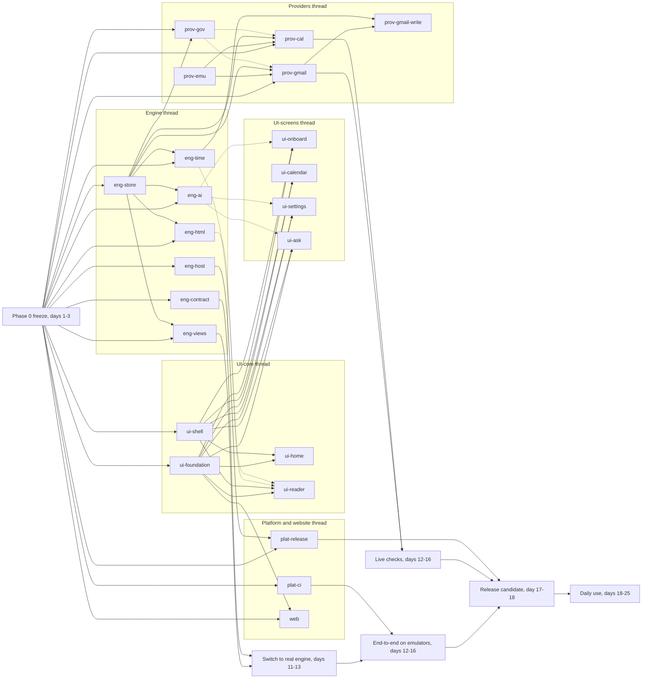

# Aplos revamp: the roadmap

Written 2026-10-27 on branch `revamp` and updated the same day after your answers. This is a plan. Nothing in it is built yet, and nothing goes to main until you merge it.

Read down to "Reference". The rest is for the coding threads.

## In plain English

Today Aplos cannot finish a real Gmail sync, keeps your whole mailbox in memory, stops when you close the window, and still resembles Avec. The revamp rebuilds the engine, the mail connections and every screen at once, and ships them as one redesigned version. The Gmail fix is part of the rebuild.

First, for two or three days, one thread writes the shared rules: the folder layout, every command the screens can send to the engine, the database layout and the design tokens. Then about 23 small lanes of work run at once, each in its own folders. Then the pieces are joined and checked on practice servers, test accounts and your mail. Last, you use Aplos daily and the threads fix what you find.

This round is Gmail and Google Calendar only. Outlook, iCloud, Fastmail and other accounts come in a later round, and until then the new version can't add them.

Six threads run the lanes. One of them, the Integrator, keeps the shared branch healthy and sends you one short summary a day. Expect a daily-use build in about two and a half weeks and a finished version in about three and a half. Nothing costs money.

## What the new Aplos will be

- Gmail shows your inbox in seconds and fills in the rest quietly, inside Google's limits. When Google refuses, Aplos waits and logs Google's reason.
- Gmail asks for a one-click reconnect each week, because the Google project stays in Testing mode. Aplos warns you a day ahead and loses nothing.
- Google Calendar syncs only what changed and keeps meeting links intact.
- Outlook, iCloud and Fastmail come in a later round on the same engine. The shared rules already cover them, so adding them changes nothing that exists.
- Mail lives in a database on your Mac that opens in milliseconds at 100,000 messages.
- Closing the window leaves Aplos in the menu bar, so mail, reminders and scheduled sends keep working.
- Each email shows in a sealed frame that can't track you.
- Background AI runs only after you agree. Groq stays the default.
- The look follows the revised mockups: quiet gray and white, roomy type, ink blue for the main action, a serif for AI text, no sky and no stripe, and a much simpler reader, reply and compose.

## The plan in days

Day 1 is the day you said go: 27 October 2026. Day 18 is 13 November and day 25 is 20 November.

| Phase | Days | What happens | What you see |
|---|---|---|---|
| 0. Freeze the shared rules | 1-3 | One thread writes the rules. Three reviewers try to break them first. | A short "frozen" note |
| 1. Wide fan-out | 4-13 | About 23 lanes build at once on demo mail and practice servers | Features reach you for review from about day 7 |
| 2. Join and check | 11-18 | Screens switch to the real engine; live checks on test accounts, then your mail | The new Aplos on your mail around day 15 |
| 3. Daily use | 18-25 | You use it as your only mail app; fixes every day or two | Done when a week passes with nothing blocking |

The longest chain runs through Gmail. The database write path is ready around day 6, Gmail passes on the practice server around day 11, and live checks run on days 12 to 15. A mistake in the shared rules, a Gmail surprise or slow joining could stretch this to about five weeks.

## Decisions already made

- **Gmail first.** This round builds Gmail and Google Calendar only. Outlook, iCloud (Apple), Fastmail and other IMAP accounts wait for round 2 (reference section 2.2).
- Your Gmail limit is confirmed: 6,000 units a minute per user and 1,200,000 a minute for the whole project.
- No 0.2.4. Pacing, subjects first, text on open, and a stop with no retries on `quotaExceeded` are built into the rebuild.
- The website and privacy page live on aplos.email (`apps/web`, Vercel).
- The Google project stays in Testing mode: up to 100 listed test users and a reconnect every 7 days, made smooth.
- Nothing costs money: no Google verification, no CASA, no paid services, no new domains.
- Keep the Gmail filter permission.
- One repo, no releases repo. You get local or private draft builds.
- Going public is decided later. In phase 3 the threads prepare a secret and history scan, notices and a draft LICENSE (GPL-3.0 app, MIT contract).
- **The agent test account.** Automatic live checks use your spare Gmail account, which you approved on 27 October for agents to read in full. They run on this Mac at set times, so no Google token sits on GitHub.
  - Agents may read all of its mail, run every AI feature over it with the Groq test key, sync and backfill all of it, label, archive, mark read, star, write drafts, add a filter they remove after the run, and send mail **only to its own address**.
  - On its own calendar, agents may create, rename, move and delete test events that the same run created, with no attendees. A Meet link on such an event is fine. They must never touch any other event (orchestrator, 2026-10-28).
  - Agents may never send to anyone else, delete permanently, empty Trash, unsubscribe, RSVP, invite attendees or change account settings.
  - Its address and its mail stay off the repo: not in commits, logs, eval reports, screenshots or PRs. PR pictures use demo mail.
  - Your main Gmail is still only touched by you, in the hand checks on days 14 to 16.
- Six threads: Engine, Providers, UI-core, UI-screens, Platform and website, Integrator.
- The weekly Gmail reconnect is a quiet line in the sidebar a day before it expires, then one click.
- Ink blue and a serif for AI text, inside the revised look.
- **You review per big feature.** About 12 features are in this round, such as Home, the reader and Gmail sync. The thread building one posts a plain-English "ready to look at" message with what to try, screenshots and a short screen recording. You give feedback, the thread fixes it and posts new pictures, and this repeats until you say it looks good. The thread then runs deep review passes (correctness, design match, tests and speed, security where it matters), opens a pull request into `revamp` and works through the review comments. If nothing you would notice changed since your approval, it merges into `revamp` itself and tells you in one line. If something did, it comes back to you with before and after pictures. Clashes between threads go to the Integrator, whose daily digest lists everything waiting on you. Pictures are made headlessly, never committed or sent to third-party sites, and show no personal data. Main stays yours.

## Decisions for you

None are open. Every question has an answer above. To change one, say so in any thread.

## What you need to do

All free.

- [x] Finish the design discussion in the mockups thread (done 27 October, folded into DESIGN.md).
- [x] Confirm the Gmail limit: 6,000 units a minute per user (done 27 October).
- [x] A separate free Groq key for tests (done 27 October, kept in this Mac's Keychain as `aplos-groq-test`).
- [x] Say go (27 October).
- [x] Add your spare Gmail account to the Google project's test users (done 27 October).
- [ ] Days 1-3: check which branch Vercel treats as production for aplos.email.
- [ ] From about day 7: review features as they arrive, about 10 to 15 minutes each, when it suits you.
- [ ] Days 14-16: about an hour of live checks on your own Gmail, including one send to yourself.
- [ ] Every 7 days: reconnect Gmail for you and the test accounts, about two minutes.
- [ ] From day 18: use it daily and report what bothers you.
- [ ] When happy: merge `revamp` and publish. Later, if you like: make the repo public.

Agents never merge to main, publish, send external mail, change repository visibility or rotate a credential.

## Top risks

- Wrong shared rules would force rework everywhere. Three reviewers attack them before the freeze, and later changes only add.
- Joining 23 lanes surfaces bugs. The real engine runs the stand-in engine's tests from day 4.
- One Gmail test account allows 6,000 units a minute, and its token expires weekly. Practice servers carry most testing.
- Your review time is scarce. The Integrator's digest queues features by priority, and no feature merges before you approve it.

---

# Reference

Everything below is reference. You don't need to read it.

This roadmap schedules the work. The binding decisions live in `plans/ARCHITECTURE.md` (ARCH) and `plans/DESIGN.md` (DESIGN, which already includes the mockup revisions, folded in on 2026-10-27). The detail lives in plans 10, 20, 30 and 40. Their milestone names (E0-E8, PV0-PV11, U0-U9, Q0-Q8) are kept as citations. This roadmap re-cuts them into lanes. Section 10 lists the edits plans 10-40 need to match it. Section 12 defines how the owner reviews each feature.

**Names.** A *lane* is a unit of work with exclusive file ownership and one Claude Code workflow (or a short series of them). A *thread* is a long-lived T3 Code thread that runs several lanes in parallel. Day 1 is the owner's "go". Days are calendar days, because agents work around the clock and the owner's reviews are the human clock.

## 1. Phase 0: what gets frozen, in what order

Phase 0 freezes exactly the things that every lane reads and no lane may change alone. After the freeze, every lane can code against them with exclusive file ownership. Target two days, plan for three. The Engine thread leads, the Integrator signs off, and the other threads prepare in their own worktrees on new files only.

### 1.1 The restructure chain (day 1, serial, about one day)

Nothing else touches existing files while this runs. Each step is its own commit, merged by merge commit and listed in `.git-blame-ignore-revs` where mechanical.

| Step | Commit | Owner | Source |
|---|---|---|---|
| 0 | NOTICE in `plans/STATUS.md`: restructure started | Engine | |
| 1 | Rename and imports: `apps/desktop/src/engine` to `packages/engine/src`, with today's engine files under `packages/engine/src/legacy/`; the shared files to `packages/contract/src/legacy/`; today's renderer to `apps/desktop/src/renderer/legacy/`; re-export stubs where needed; workspaces, tsconfig paths, Vite alias, esbuild bundling `@aplos/*`; recursive portability test; `npm run package` and `verify-release.mjs` pass | Engine | Plan 10 E1 item 1 and section 3, amended |
| 2 | Prettier format commit over the moved tree, proved by identical minified output | Platform prepares, lands in the slot | Plan 40 Q1a |
| 3 | Split `apps/desktop/src/main/electron.ts` into owned modules: `windows.ts`, `lifecycle.ts`, `protocol.ts`, `menu-bar.ts`, `native-methods.ts`, `security.ts`, `updater.ts`, `engine-host.ts`. Code moves only. | Engine | Plan 10 section 3 and E1 |
| 4 | ESLint flat config, bulk suppressions, import boundaries, pre-commit hook, `static` job | Platform prepares, lands in the slot | Plan 40 Q1b |

The legacy folders keep building and keep their tests green. They are read-only reference until Phase 2 deletes them. There is no typed-client codemod over today's 53 `invoke(` sites and no legacy bridge, because no release ships today's screens on the new engine (section 10 lists the plan edits).

### 1.2 The frozen artifacts (days 2-3, parallel on new files)

| # | Artifact | Path | Written by | Reviewed by |
|---|---|---|---|---|
| F1 | Contract v1: every method name with zod input and output schemas, all frames (`state`, `window`, `progress`, `reset`, host channel) with `{dbEpoch, seq}` tokens and receipts, error types, the classified-error record, the status vocabulary including `paused(until, reason)`, `backfilling(n of m)` and the new `reconnectBy` time, the `Setup/status` shape, the Thread row with `partial`, `Mail/frame`, capability flags, the `Settings` schema with its `ui` object and per-feature AI provider and model, the logger event catalog | `packages/contract/src/**` | Engine | All three reviewers |
| F2 | Generated allowlists and the typed client `api.*`; the registry drives `preload.ts`, `engine-host.ts` and `server.ts` | `packages/contract/generated/**`, `src/client/**` | Engine | Platform |
| F3 | Ports: `ProviderAdapter` with `CalendarAdapter` and `findSent`, `GovernorPort`, `AccountActorHost`, `SendPort` with `NotSentError`, `DraftSyncPort`, `ProviderPort.openThread`, `Clock`, deadline-source registration, `KeyProvider`, `MailHtml`, `Logger`, `StorePort`, `laneFor` | `packages/engine/src/ports.ts` | Engine, from Providers' proposal for the provider ports | Providers |
| F4 | Database: migration framework, `mail.db` schema 0001 (ARCH 3.2 plus plan 20's review items: recurrence id on `events`, `message_folders` keyed for IMAP placements, `sync_state`, `governor_state`, the account's token-grant time), the `store.commit` signature and a minimal working commit that writes `changes` and bumps `seq` | `packages/engine/src/store/migrations/0001*`, `store/port.ts` | Engine | Providers |
| F5 | Method dispatch table mapping every contract method to one module file (`methods/<area>.ts`), each a stub that throws `NotImplemented`, so lanes fill their own file and never edit the shared table | `packages/engine/src/methods/index.ts` | Engine | Integrator |
| F6 | Stand-in engine answering every method on the `demo` and `empty` scenarios, the `Fixture/control` signatures, and the conformance suite layout. Lane `eng-contract` fills in the other scenarios during Phase 1 | `packages/contract-fixture/**`, `packages/contract/tests/conformance/**` | Engine | UI-core |
| F7 | Logger and redacting log sink at final paths | `packages/engine/src/diag/log.ts`, `apps/desktop/src/host/logsink.ts` | Engine | Platform |
| F8 | `APLOS_TEST=1` and `APLOS_DATA_DIR` honoured in main (isolated data, no single-instance lock, no Dock or menu-bar item, windows created hidden) and the pinned Playwright base | `main/lifecycle.ts`, `tests/e2e/playwright.config.ts` | Engine, Platform | Integrator |
| F9 | Design tokens from the revised DESIGN.md (`tokens.json`, generator, `tokens.css`, `motion.ts`, contrast pairs), the design lint rules, the `aplos-design` skill v1, the component list with frozen props, the `CommandRegistry` interface, and the renderer data-hook signatures (`useView`, `useRow`, `api`, receipts) | `apps/desktop/src/renderer/{ui,commands,data}/**` (interfaces), `scripts/design/**`, `tools/lint/design/**`, `.claude/skills/aplos-design/**` | UI-core | UI-screens |
| F10 | Ownership map, path-ownership CI check, `plans/STATUS.md` | `plans/OWNERS.md`, `scripts/audit/owners-check.mjs` | Integrator, Platform | Everyone |

### 1.3 The freeze review (day 3, half a day)

Three adversarial reviewers, each a fresh agent given the artifacts but not the authors' reasoning, try to find what cannot be expressed:

- The UI reviewer walks every mockup screen and DESIGN section 5 and 7 and lists each behaviour the contract or data hooks cannot express. It also checks plan 30's twelve asks (plan 10 section 4.1 table).
- The Providers reviewer runs Gmail, IMAP, JMAP, Graph and CalDAV through `ProviderAdapter`, `GovernorPort` and schema 0001 on paper, including the weekly reconnect and the lease.
- The security and platform reviewer checks the registry tags and scopes, the transports, `Mail/frame`, the log catalog against ARCH 11 and 12, and the 400,000-byte engine budget.

The Engine thread fixes every gap. The Integrator tags `contract-v1` on `revamp` and posts FROZEN in STATUS.md. After that, changes are additive within `v:1`, proposed with CONTRACT-CHANGE-PROPOSED, and made only by lane `eng-contract`.

### 1.4 What the other threads do during Phase 0

| Thread | Phase 0 work |
|---|---|
| Providers | Propose `ProviderAdapter`, the status vocabulary and the reconnect fields by the morning of day 2; review schema 0001; build the Gmail emulator in `packages/emulators/gmail` until it reproduces 0.2.3's failure; write each lane's test plan |
| UI-core | F9, in its own worktree, merged after step 4 |
| UI-screens | Map each mockup screen to its DESIGN section and the contract methods it needs, and send the gaps to the UI reviewer; plan PR #21's absorption; draft harness scenarios |
| Platform and website | Prepare Q1a and Q1b for their slots; CI slots (`check:tokens`, `check:contrast`, `check:identity`, `test:visual`, `test:perf`); the owners check; after step 2, start the website in `apps/web` |
| Integrator | STATUS.md, OWNERS.md, git identity checks, the freeze checklist, the three reviewers, the merge procedure |

> **What this means:** For two or three days one thread restructures the code and writes the shared rules while everyone else prepares. Three reviewers try to break the rules before they freeze, because a mistake there costs the most later.

## 2. The lanes

Each lane owns its paths exclusively. A pull request that touches a path outside its lane fails the owners check unless the owning lane approved it. "Needs" lists only real dependencies after the freeze. Before a dependency lands, the lane codes against the frozen port with a stub or the stand-in engine.

### 2.1 Engine thread

| Lane | Owns | Implements | Needs | Days |
|---|---|---|---|---|
| `eng-contract` | `packages/contract/**`, `packages/contract-fixture/**`, `packages/engine/src/{runtime/**,methods/index.ts,methods/session.ts,methods/settings.ts}`, `host/transports/port.ts`, `main/engine-host.ts`, `main/server.ts`, generated part of `preload.ts` | Plan 10 section 4.1 and E1 items 3, 6, 7; the transport half of E3 (direct `MessagePort`, main out of the data path); ARCH 9 | Phase 0 lead | 1-3, then 4-10 |
| `eng-store` | `packages/engine/src/store/**` (incl. `store/import/**`), `packages/engine/bench/**` | Plan 10 E2 deliverables 1-11 and "The import"; ARCH 3 | F4 | 4-10 (real commit, ids, change log by 6; bodies, search, retention by 9; importer by 10) |
| `eng-views` | `packages/engine/src/views/**`, `methods/{view,thread,operation}.ts` | Plan 10 E3 (view specs, window engine, holds, receipts, `Thread/act`, `Operation/undo`); ARCH 9.2 | Real store from day 6 | 4-11 (conformance green on the real engine by 11) |
| `eng-time` | `packages/engine/src/{outbox,clock}/**`, `methods/{submission,draft,outbox,later,reminder,notification}.ts` | Plan 10 E6 (submissions, undo and send later, overdue, drafts, one timer loop, notification outbox); ARCH 7 | Real store | 4-10 |
| `eng-ai` | `packages/engine/src/ai/**`, `methods/{ai,ask,setup,demo,consent,queue}.ts`, `apps/desktop/src/host/ai/**` (today's `main/{groq,llm,ollama,anthropic,ai-keys}.ts` move here) | Plan 10 E5 (jobs, AI governor and budget, consent, heuristic Home, `Setup/*`, `Demo/*`); ARCH 8 | Real store; `eng-views` for Home ranks | 4-11 |
| `eng-html` | `packages/mail-html/**`, `host/protocol/**`, `host/proxy/**`, `main/protocol.ts`, `methods/mail.ts` | Plan 10 E4 (sanitizer, `Mail/frame`, tokens, image proxy); ARCH 10 | Bodies from `eng-store` | 4-10 |
| `eng-host` | `main/{lifecycle,menu-bar,windows,native-methods}.ts`, `host/{lifecycle,power,lock,crash}.ts`, `packages/engine/src/selftest.ts`, `host/transports/{socket,http}.ts`, `host/{mcp,cli}/**`, `packages/engine/src/diag/bundle/**`, `methods/{diagnostics,listener,clients}.ts` | Plan 10 E1 items 4-5 (resident mode, lock, wake, parked, self-test) and E7 (socket, loopback HTTP, clients and scopes, OpenAPI, MCP, diagnostics); ARCH 2, 11, 12.3 | none beyond freeze | 4-12 (resident by 7, doorway by 12) |

### 2.2 Providers thread

| Lane | Owns | Implements | Needs | Days |
|---|---|---|---|---|
| `prov-emu` | `packages/emulators/**`, `apps/desktop/scripts/live/**`, `scripts/smoke/probes/**` | Plan 20 PV1a, the Google Calendar fake from PV1b, sections 5.4-5.5 (live harness, experiments register) | none | 1-9 (Gmail by 4, Google Calendar by 6, live runner by 9) |
| `prov-gov` | `packages/engine/src/sync/**`, `host/providers/shared/**`, `host/providers/oauth/**` (today's `main/oauth-config.ts`), `methods/{account,sync}.ts` | Plan 20 PV2 and the lease; the free parts of PV5 (client resolution for source builds, scope manifest and its test, granted-scope handling); the weekly-reconnect engine side (grant time, `reconnectBy`, `login_hint`, reconnect without resync, queued local changes kept) | Real store | 4-9 (shared HTTP client and classifier by 5, governor by 7, accounts by 9) |
| `prov-gmail` | `host/providers/google/{client,sync,history,bodies,search,workflow,classify}.ts` | Plan 20 PV3 with every PV0 deliverable and acceptance item folded in (pacing, four error classes, `quotaExceeded` stop, no retries, metadata-first window, lazy bodies, cheap history rule, search on Enter, granted scopes, exact-reason logging, EX1-EX3) | Gmail emulator; real store; real governor from day 7 (stub before) | 4-12 (emulator gate by 11) |
| `prov-gmail-write` | `host/providers/google/{send,drafts,filters,unsubscribe}.ts`, `methods/unsubscribe.ts` | Plan 20 PV4 | `prov-gmail` client by 6; `eng-time` submissions and drafts | 6-12 |
| `prov-cal` | `packages/engine/src/calendar/**`, `host/providers/google/calendar*.ts`, `methods/event.ts` | Plan 20 PV8's recurrence module and PV9's Google Calendar part with RSVP | Google calendar emulator | 5-13 |

**Round 2 (not in this round).** `prov-imap` (PV6: IMAP, SMTP, iCloud, Yahoo, generic), `prov-jmap` (PV7: Fastmail), `prov-graph` (PV10: Outlook mail), the CalDAV half of PV8, the Graph half of PV9 and the IMAP, JMAP, DAV and Graph fakes of PV1b. The owner deferred them on 2026-10-27 so this round can make Gmail excellent. Phase 0 still freezes a contract, ports and schema that fit every provider (the Providers freeze reviewer still walks all five through `ProviderAdapter` on paper), so round 2 adds lanes and changes nothing frozen. Today's adapters in `apps/desktop/src/main/{microsoft,imap*,jmap,caldav}.ts` stay untouched as reference; onboarding offers only Google until round 2. Round 2 also needs the free Microsoft Entra app, which requires an Azure sign-up with a card (section 8).

### 2.3 UI-core thread

| Lane | Owns | Implements | Needs | Days |
|---|---|---|---|---|
| `ui-foundation` | `renderer/ui/**`, `renderer/commands/**`, `scripts/design/**`, `tools/lint/design/**`, `.claude/skills/aplos-design/**`, `tests/visual/**`, `tests/perf/**`, fonts | Plan 30 U1 and U3 (tokens, lint, skill, registry, harness with the hover-never-shifts check, components); U0's checks (banned strings, identity, AGENTS.md rule, retiring "match the reference" decisions); DESIGN 4, 6, 12 as revised | Revised DESIGN.md | 1-3 (F9), then 4-9 |
| `ui-shell` | `renderer/{data,shell,motion}/**`, `renderer/App.tsx`, `renderer/main.tsx`, `renderer/bridge.ts` | Plan 30 U2 and section 4.1 (data layer), U4 (motion as revised), U5's shell, sidebar, pane header, status slot, toasts and trays, and WP5.6 (the switch to the real engine, run in Phase 2); the reconnect note in the status slot | F6, F9; `eng-views` for the switch | 4-11 |
| `ui-home` | `renderer/screens/{home,later,lists,done}/**` | Plan 30 U5's screens (Home, Later, All mail, Drafts, Sent, Trash, Spam, labels, the new Done place, one-by-one, empty states); DESIGN 7.2-7.4, 7.14 | `ui-foundation` components; `ui-shell` hooks | 5-12 |
| `ui-reader` | `renderer/screens/{reader,compose}/**`, `renderer/mailframe/**` | Plan 30 U6 and section 4.4 (reader, mail frame on `srcdoc` against the stand-in engine until `eng-html` lands, inline reply, compose, outbox and undo tray); DESIGN 7.5-7.6 | `eng-html` for the real frame; `eng-time` for real send states | 5-13 |

### 2.4 UI-screens thread

| Lane | Owns | Implements | Needs | Days |
|---|---|---|---|---|
| `ui-onboard` | `renderer/onboarding/**`, `main/windows/onboarding.ts` | Plan 30 U8 (onboarding window, first-sync screen, consent, demo on request, PR #21's screens absorbed by path, Appendix C findings); the reconnect sheet; DESIGN 7.11-7.12 as revised | `eng-ai` `Setup/*` for Phase 2; `prov-gov` status facts | 5-12 |
| `ui-calendar` | `renderer/screens/calendar/**` | Plan 30 U7's Calendar; DESIGN 7.8 | `prov-cal` fields (frozen in F1) | 6-12 |
| `ui-settings` | `renderer/screens/settings/**` | Plan 30 U7's Settings (accounts with reconnect, AI providers and a model per feature, appearance, keyboard, tools on this Mac, diagnostics, retention); DESIGN 7.10 | `eng-host` listener methods; `eng-ai` provider table | 6-12 |
| `ui-ask` | `renderer/screens/{ask,today,palette,search}/**` | Plan 30 U7's command palette, search, Ask dock and Today; DESIGN 7.7, 7.9 | `eng-ai` Ask frames | 6-13 |

### 2.5 Platform and website thread

| Lane | Owns | Implements | Needs | Days |
|---|---|---|---|---|
| `plat-ci` | `.github/workflows/ci.yml`, `tools/lint/**` except `design/`, `tests/e2e/**`, `budgets.json`, `scripts/audit/**`, `scripts/smoke/**` except probes | Plan 40 Q1 (Phase 0 slots), Q3 (CI, emulator E2E, budget register), Q4 (AI eval replay, live smoke runner on the agent test account) | none | 1-3, then 4-12 |
| `plat-release` | `apps/desktop/build/**` except the DMG background, `main/{security,updater}.ts`, `.github/workflows/release.yml`, `scripts/{release,verify-release,release-build}.mjs`, `RELEASING.md`, `THIRD_PARTY_NOTICES*`, `LICENSE` draft, `docs/release-checklist.md` | Plan 40 Q0 without the releases repo, Q2 (fuses, permission handler, CSP stages, unfused E2E build), Q7a and Q7b (draft releases in this repo, verifier, beta channel, Keychain evidence), Q6 without CASA or the paid name search, Q8's release gate | `eng-host` self-test; `eng-html` for the CSP stage 2 | 4-14, OSS prep in Phase 3 |
| `web` | `apps/web/**`, `apps/desktop/build/dmg-background.html` | Plan 40 Q5A and Q5B; remove the stripe and fix untrue claims only; the full site redesign waits for the new logo (owner, 2026-10-27); the privacy page on aplos.email with Google's Limited Use sentence, what is stored, what leaves the Mac, no telemetry and how to delete data; Gmail described as available to invited testers | F9 tokens | 2-8 |

### 2.6 After Phase 1

| Work | Implements | Who | Days |
|---|---|---|---|
| Switch to the real engine | Plan 30 WP5.6 | `ui-shell` with the Integrator | 11-13 |
| End-to-end journeys on emulators | Plan 40 Q3 emulator E2E | `plat-ci`, Integrator | 12-16 |
| Live checks | Plan 20 section 5.4; PV3, PV6, PV7, PV9 live gates | Lanes run tier R on test accounts; the owner runs checks on their own accounts | 12-16 |
| Delete legacy folders and old provider files | Plan 10 E8 item 4, plan 20 section 3.1 | Integrator with each owning lane | 14-17 |
| Hardening and soak | Plan 10 E8, plan 20 PV11 (soak runs in the background during Phase 3) | Engine, Providers | 15-25 |
| Accessibility, performance, release candidate | Plan 30 U9, plan 40 Q8 | `ui-foundation`, `plat-release`, Integrator | 15-18 |

> **What this means:** 23 lanes this round (three more in round 2), each owning its own folders, built against the frozen rules. Most finish within about 10 days. The Gmail lane and the reader take longest.

## 3. Dependency graph

Solid arrows are hard dependencies. Dashed arrows mean the lane starts on a stub or the stand-in engine and swaps in the real piece when it lands.

## 4. Critical path and day plan

### 4.1 The critical path

1. **Gmail chain, the longest.** Freeze (day 3), then `eng-store`'s real `store.commit`, ids and change log (day 6), then `prov-gmail` on the real store and, from day 7, the real governor, to the emulator gate (day 11). Then scheduled live runs on the agent test account (days 12-14) and the owner's hand-run check on their own Gmail (days 14-15). Fixes and the release candidate follow (days 17-18), then a week of daily use (days 18-25).
2. **Screens chain, close behind.** Freeze with F9 (day 3), then components and data hooks (days 4-8), then screens on the stand-in engine (days 5-13). `eng-views` passes the conformance suite on the real engine (day 11), the switch follows (days 11-13), then end-to-end on emulators (days 12-15) and the owner's look check on real mail (day 15). It meets the Gmail chain at the release candidate.
3. **Near-critical.** `ui-reader` (needs `eng-html` and `eng-time`), and `prov-cal` (repeating events and Google Calendar's meeting links).

### 4.2 Range

| Case | Daily-use build | Finished version | Assumes |
|---|---|---|---|
| Best | day 15 | day 22 | No contract gaps, Gmail live passes first time, reviews same day |
| Likely | day 17-18 | day 25 | One contract addition, one Gmail live fix, a day of review wait per feature |
| Slow | day 25 | day 35 | A contract change that breaks lanes, a second cause behind Gmail's refusals, a design rework, agent rate limits |

### 4.3 Owner touchpoints by day

| Day | Event |
|---|---|
| 1 | Go; test accounts and test users; Vercel check (design, Groq key and the 6,000-unit check were done on 27 October) |
| 3 | Freeze note (5 lines, optional read) |
| From about 7 | Feature reviews (section 12). A feature reaches you when it works on demo or practice data, with steps to try, screenshots and a recording. Each look takes about 10 to 15 minutes. The first main screens arrive around day 9. Several can wait at once; the daily digest lists them |
| 7, 14, 21 | Weekly Gmail reconnect for you and the test accounts |
| 14-16 | Live checks by hand, about an hour, from the Integrator's checklist: your own Gmail, one real send to yourself with a mid-send kill, a real onboarding, keys with focus inside an email, and a one-minute lid close |
| 17-18 | Install the release candidate; start daily use |
| 18-25 | Daily use; a quick VoiceOver and input-method check; one weekly reconnect happens inside this week, which tests the reconnect flow for real |
| 25 | Sign off; merge `revamp` into main and publish when you choose |

## 5. Threads

### 5.1 Mapping

| Thread | Lanes | Peak concurrent workflows | Models |
|---|---|---|---|
| Engine | `eng-contract`, `eng-store`, `eng-views`, `eng-time`, `eng-ai`, `eng-html`, `eng-host` | 7 | Opus for the contract, store, views, outbox, sanitizer, proxy and doorway security; Sonnet for scoped work; cheap models for mechanical moves |
| Providers | `prov-emu`, `prov-gov`, `prov-gmail`, `prov-gmail-write`, `prov-cal` (round 2 adds `prov-imap`, `prov-jmap`, `prov-graph`) | 5 (gmail-write starts later) | Opus for the governor, Gmail sync, lease and recurrence; Sonnet or strong open-weight models for emulators and well-specified adapters |
| UI-core | `ui-foundation`, `ui-shell`, `ui-home`, `ui-reader` | 4 | Claude only: Opus for the data layer, motion, Home, reader and mail frame; Sonnet for routine work |
| UI-screens | `ui-onboard`, `ui-calendar`, `ui-settings`, `ui-ask` | 4 | Claude only: Opus for onboarding and Calendar layout; Sonnet for Settings and routine screens |
| Platform and website | `plat-ci`, `plat-release`, `web` | 3 | Opus for hardening and release security; Claude for the website; cheap models for CI plumbing |
| Integrator | none; dependency and infrastructure merges, the full suite, the conformance burn-down, Phase 2 lead, the owner's review queue and digests | 1 plus reviewers | Opus for judgement; Haiku for test runs and summaries |

### 5.1a Lean mode: the token budget (owner, 2026-10-28; SWE-2 routing 2026-10-29; replaces the earlier routing rules)

> **What this means:** Devin's SWE-2 (free through November) takes the volume work, Sonnet runs the threads and does UI, tricky code and reviews, and Opus takes the hardest and riskiest calls. Quality comes first; SWE-2 is extra capacity, not a downgrade. Agents read less, live shorter, and fewer of them run at once. Tests and one review per change keep quality where it was.

**Why.** In the first 26 hours the revamp hit Claude's 5-hour limit three times. The causes, measured from the logs:
- Opus made about 87% of the calls, because subagents inherit their parent's model and every parent was Opus.
- The average call re-read about 200,000 tokens of context, and over 1,300 calls re-read more than 400,000, because threads lived forever and agents read whole plans.
- Orchestrators were nested three layers deep.
- Every PR got multi-round Opus review panels.
- The orchestrator and the Integrator polled every 30 minutes.
- About 20 agents ran at once. The limit caps work per 5 hours, so running wider only hit the cap sooner.

**Models.** Every agent, workflow and delegate names its model explicitly. Nothing inherits.

| Tier | Model | Use for |
|---|---|---|
| Volume (free through November) | Devin `swe-2-high` (`delegate_task` provider `acpRegistry_devin`; `thought_level` `max` for harder items) | Well-specified non-UI code a subagent writes: scoped features from a lane card, bug fixes with a repro, tests, fixtures, scripts, CI, file splits, lint fixes. Also codebase searches, plan reading, test-run summaries, first-pass reviews and extra parallel attempts. Keep each task scoped and testable; it is weak at long open-ended terminal sessions |
| Sonnet | `claude-sonnet-5-5` | Thread orchestrators; all UI code (renderer and site); non-UI work with tricky logic, cross-module changes or unclear specs; the one Claude review per PR; and any task where SWE-2's result is not clearly as good |
| Opus | `claude-opus-5-5` | Contract changes; security code (send guard, live-run guard, sanitizer and frame, hardening, auth and tokens); the store's commit path and sync correctness; the final review of PRs in those areas; high-visibility UI; and really hard work: architecture calls and subtle bugs Sonnet could not crack |
| Haiku | `claude-haiku-5-5` | Trivial checks when Devin is down |

**Quality comes first.** SWE-2 is extra capacity, not a downgrade: pick the model that gives the best result for each task. When unsure between SWE-2 and Sonnet, use Sonnet; when a SWE-2 result falls short, redo it on Sonnet rather than patching around it. The savings come from moving volume (mechanical code, tests, searches, reading, extra attempts and first-pass reviews) to SWE-2, not from moving judgment off Claude.

OpenCode and Cursor Grok are retired for this project (they were never used in practice). If Devin is down or rate-limited, fall back to Sonnet, not to free models.

**SWE-2 is free, so spend it.** Claude usage stays lean; SWE-2 does not need to be:
- Up to 6 SWE-2 subagents at once per thread (Claude subagents stay at 4), limited by machine load: run full `npm run check` suites one at a time.
- SWE-2 may read whole plans and files; the lane-card reading limits below apply to Claude agents.
- For a tricky item, run two SWE-2 attempts in separate worktrees and keep the better one.
- Give SWE-2 a first-pass review (bugs, tests, lane rules) before the Claude review, so the Claude review is short.
- Briefs for SWE-2 are complete and self-contained: goal, lane card path, owned paths, done criteria and test commands. It never sees `.env` or keys.

**Context.**
- **Lane cards.** Each lane has a lane card of at most one page in `plans/lanes/<lane>.md`: goal, owned paths, the exact plan sections and line ranges to read, done criteria and test commands. Agents read the card and only the sections it names, never whole plans. The 22,000-word DESIGN.md is read by section only.
- **Fresh threads.** A thread whose context passes about 150,000 tokens writes `plans/<thread>/HANDOFF.md` (at most one page), and a fresh thread continues from it. Subagents are one task each and end when it's done.
- **Short STATUS.** `plans/STATUS.md` keeps only the last 3 days. Older entries move to `plans/status-archive/`. Agents read only new lines (`git diff` since the last read), not the whole file.
- **No pasting.** No raw test or build logs in context: scripts summarize results to pass or fail counts plus the first failure.

**Structure.**
- At most two layers: a thread runs its own subagents directly. No lane-lead orchestrators or delegates that spawn more delegates.
- At most 3 building threads plus the Integrator at once, working down the critical path. The others are parked until their inputs exist.
- At most 4 concurrent Claude subagents per thread, plus up to 6 SWE-2 subagents.

**Reviews.**
- One Sonnet review per PR, of the diff only, plus passing tests.
- An Opus adversarial review only for the Opus areas above.
- No multi-round panels: a second review round only checks the fixes for the first round's findings.
- SWE-2 code always gets the Sonnet review (after its own SWE-2 first pass).

**Polling.**
- No agent polls.
- `plans/tools/watch.sh` checks STATUS, PRs and thread state in shell. An agent wakes only when it prints a change, and that agent starts as a fresh small thread.
- The Integrator is event-driven: it merges when a READY or HANDOFF-READY entry appears.

**Measurement.** `python3 plans/tools/token-report.py` prints tokens by model and by thread since a given time. The daily digest includes one line from it. If Opus goes above 25% of calls, or the average context goes above 120,000 tokens, the orchestrator tightens routing the same day.

**Unchanged:** every test gate, the security reviews, the owner's feature review loop, and the hard rules.

### 5.1c Hill climbing (owner, 2026-10-29)

> **What this means:** agents improve code in rounds against automatic scores. Several attempts run in parallel, each is scored, and only a better one that breaks no gate is kept. SWE-2 makes most attempts for free; Claude judges taste and reviews the final result.

**The loop.** For a target (a screen, a module or an AI prompt):
1. Score the current code with the target's scorers and run its gates.
2. Start N attempts in parallel, each in its own git worktree, with the brief, the current scores and the worst findings.
3. Score every attempt. Keep the best one only if its combined score is higher and every gate still passes.
4. Repeat from the new best. Stop after 2 rounds without gain or at the round limit (default 5 rounds of 4 attempts).
5. The thread opens a normal PR from the result. It gets the usual Sonnet review (Opus in the named areas).

**Gates** (must pass, never traded for score): the lane's tests, typecheck, the owners check, the security checks in the target's area, and no regression on any scorer marked `noRegress`.

**Anti-gaming.** An attempt may only touch the target's allowed paths. The harness rejects any diff that touches scorers, gates, test expectations, baselines, budgets, suppression files (except to shrink them), mockups or DESIGN.md. AI prompt targets score on a dev set and must not regress on a held-out set the attempts never see.

**Who makes the attempts** (owner's choice "C"):
- SWE-2 for all non-UI targets, and for the mechanical UI checks: accessibility (axe), design lint, stylelint and contrast.
- Sonnet for visual or taste work on screens (Opus for high-visibility screens), 2–3 attempts per round. A Sonnet taste judge scores screenshots against DESIGN.md and the matching mockup.
- Visual changes to a screen happen before its READY-FOR-OWNER. After the owner approves, a hill climb may only change things that keep the approved look; anything visible goes back to the owner.

**Scorers by area:**

| Area | Existing | To add |
|---|---|---|
| UI | `lint:design`, `check:contrast`, `check:tokens`, `check:budgets` | axe (approved 2026-10-29), visual diff against `mockups/`, Sonnet taste judge |
| Engine and providers | tests, typecheck, `bench:mailbox`, `check:budgets`, ESLint suppression count | coverage, mutation testing (Stryker), dead code (knip), layer rules (dependency-cruiser) |
| AI features | `eval:groq`, `eval:ask` | dev and held-out splits |

**Builders.**
- Platform (`plat-ci`) builds the harness, `npm run hillclimb -- <target config>`, in `scripts/audit/hillclimb/`, plus the non-UI scorers.
  - A target config lists its allowed paths, gates, weighted scorers (each a command that prints `{"score": n, "details": [...]}`), the model per attempt, attempts per round and the round limit.
  - Attempts run headless: SWE-2 with `devin -p --model swe-2-high` in the attempt's worktree, Claude with `claude -p --model <model>`.
  - It takes the shared check slot (`scripts/audit/slot.mjs`) so full suites never overlap.
  - It prints a score table per round, no raw logs.
- UI-core (`ui-foundation`) builds the UI scorers (axe, visual diff, taste judge) in `tests/visual/`.
- Engine (`eng-ai`) adds the dev and held-out splits to the AI evals.
- Each thread keeps its target configs in its own lane paths.

**Where it runs.** Heavy rounds run on kainoas-linux-mba, because the Mac is loaded.

### 5.1b Machines (owner, 2026-10-28)

> **What this means:** tests that only need a headless browser or Node run on the Linux box when it helps the Mac; anything needing macOS stays on the Mac.

- **This Mac:** the Integrator and Engine (Electron host, Keychain, live Gmail runs), plus Platform's release and hardening work.
- **Linux box (`kainoas-linux-mba`, its own T3 server, repo at `~/Dev/aplos-mail`, Node 24 through nvm):** browser-tested UI work (UI-core, UI-screens) and Node-only provider work, when they're active.
- Threads on different machines talk only through STATUS. Live Gmail runs and Mac-only checks go to the Integrator as a REQUEST in STATUS.

### 5.2 Why six

- **Merge conflicts** depend on path ownership, not on thread count. The owners check makes cross-lane edits fail in CI, so more lanes do not mean more conflicts. Thread count matters for coordination. Each orchestrating thread keeps at most about eight workflows in view.
- **UI gets two threads** because it is the second-longest chain and Claude-only. One thread holds the shared UI foundation and the two hardest screens. The other holds four independent screens. With one UI thread, eight UI workflows would queue behind one orchestrator and the screens chain would become the longest by about four days.
- **The Integrator is separate** because merging the dependency and infrastructure pull requests, running the full suite after every feature merge and guarding conformance is a full-time job. The Engine thread changes the contract, so it should not also judge every merge.
- **Owner load.** The owner reads one daily digest from the Integrator and reviews features as they arrive, not six streams. Fewer threads would not cut that reading; more would raise merge-queue pressure on the Integrator.

## 6. Bottlenecks and what the plan does about them

| Bottleneck | Mitigation |
|---|---|
| Contract and schema freeze quality | Three adversarial reviewers from the consumers' side, the 4.1 checklist of UI asks, Providers walking every adapter through the ports, additive-only changes after the freeze, one owner (`eng-contract`) |
| Merge conflicts | Exclusive paths in `plans/OWNERS.md` enforced by `owners-check`; one shared dispatch table frozen with one file per lane; small PRs (one work package, ideally under 500 changed lines excluding generated files); lanes merge `revamp` into their branch before each PR; the Integrator merges dependency and infrastructure PRs continuously; features merge once, after approval |
| Gmail quota for live tests | Emulators first: the Gmail emulator must reproduce 0.2.3's failure before anything is tested on it. Live runs are scheduled, read-only first, each under 3,000 units a minute, on the agent test account (per-user quota, so a second account doubles the room). Runs follow the weekly reconnect. |
| Testing mode's 7-day tokens | Weekly reconnect ritual covers the owner and test accounts together; the live runner checks `reconnectBy` before starting and skips with a clear message |
| Owner review time | Per-feature reviews with steps to try, screenshots and a recording; the Integrator queues them by priority in the daily digest; the owner judges behaviour and feel, never code; agents verify everything a machine can; features that need no judgement have no owner review |
| Integration bugs | The conformance suite runs against both the stand-in and the real engine from day 4, with a shrinking expected-fail list; the switch happens on day 11, not at the end; daily end-to-end on emulators from day 12; providers not ready by day 16 ship switched off rather than holding the release |
| Machine and CI limits | Many agents share one Mac. Lanes run targeted tests; only the Integrator runs the full suite. GitHub Actions runs on pushes to `revamp` only, Linux only, to stay within free minutes; macOS jobs run on demand. If the owner allows it, the Linux MacBook Air can serve as a free self-hosted runner. |
| Agent rate limits | Threads start the critical lanes first (`eng-store`, `prov-gmail`, `eng-views`, `ui-shell`, `ui-reader`) and stagger the rest |
| Design still moving | The mockup revisions were folded into DESIGN.md on 2026-10-27; tokens live in one file; the mockups are the visual target |
| Token cost | Acceptable per the owner. Threads still avoid overlapping agents and do not fan out work that is not parallel. |

## 7. Branch and merge strategy

- `main` holds released code only. Nothing goes to main until the owner merges `revamp` for the redesigned release. Agents never merge into main.
- `revamp` is the integration branch. Two kinds of pull request go into it.
  - **Dependency and infrastructure PRs.** These are small and show the owner nothing new: ports, adapters, store functions, anything another lane's "Needs" column names, and all work from lanes with no owner review. The Integrator merges them after typecheck, tests, `npm run check`, the owners check, the conformance run and a review by an agent that did not write them.
  - **Feature PRs.** One per lane per owner-visible feature. The owner approves the feature first. The thread then runs the deep review passes, opens the PR, handles the comments and merges the PR itself if nothing user-visible changed materially since the approval (section 12). The Integrator runs the full suite after each such merge and reverts a red one.
- The one exception is STATUS.md entries, which any thread pushes directly (`git pull --no-rebase` first, never force).
- Lane branches are `rv/<lane>/<slug>`, for example `rv/eng-store/commit`, `rv/prov-gmail/history`, `rv/ui-home/triage`. A feature's branch is the lane branch that carries it. Inside a thread, subagents merge their work packages into that branch, and the thread opens one PR when the owner has approved. Each branch runs in its own git worktree. Thread coordination branches are `rv/thread/<name>`. No branch name is ever a folder of another, so there is never a branch named exactly `rv/<lane>` or `rv/thread`. `rv/ui/mockups` stays as the design thread's branch.
- At launch, the `mockups/` folder from `rv/ui/mockups` is merged into `revamp` as read-only visual reference.
- Merge style: Phase 0's mechanical commits merge by merge commit and go into `.git-blame-ignore-revs`. Everything else squashes, naming the lane and feature or work package. Long-lived branches take `revamp` by merge, never rebase. Nobody force-pushes a shared branch.
- Evidence (test output, numbers, the approved headless screenshots in both themes) goes in the PR with `gh pr create --attach`, never committed. Review is batched per feature, and nobody re-triggers Cubic after every fix; a thread requests at most one re-review.
- Contract changes go only through `eng-contract`, labelled `contract-change`, additive within `v:1`. A thread never merges a `contract-change` PR itself; the Integrator does.
- A feature PR is the one exception to the 500-line guide for small PRs.
- Builds: local packaged builds, or `v0.3.0-beta.N` draft releases in this private repo on the owner's go-ahead. The owner installs them by hand. The stable redesigned release is proposed as 0.3.0, tagged from main after the owner merges.
- Commits are authored as Kainoa Newton <k@kainoa.me>. Threads flag any other `git config user.email` before committing. PR #21 is never merged; `ui-onboard` absorbs its screens by path and the owner closes it.

> **What this means:** Every lane works on its own branches and its own folders. Small plumbing PRs go through the Integrator. A feature you have approved merges into `revamp` by its own thread, unless something you would notice changed, and then it comes back to you. Main changes once, when you choose.

## 8. Decisions

### 8.1 Answered by the owner on 2026-10-27

| Old # | Question | Answer |
|---|---|---|
| 1 | Ship 0.2.4 now? | No. The Gmail fix is built into the rebuild |
| 2 | Which domain? | aplos.email, already owned; `apps/web` on Vercel |
| 3 | Testing to Production? | Stay in Testing. 100 test users, weekly reconnect, made smooth |
| 4 | Google review and CASA? | No. Nothing that costs money. See 8.4 |
| 5 | Keep the Gmail filter permission? | Yes |
| 6 | Where do downloads come from? | This repo. No releases repo. Public later, the owner's call |
| 7 | Which mailboxes may automatic live checks use? | The owner's spare Gmail account, approved 2026-10-27 for full reading and AI, under the agent test account rules in "Decisions already made" |
| 8 | How many threads? | Replaced by new decision N1 |
| 9 | One big release with betas? | Yes, one redesigned release, no 0.3.0/0.4.0 split |
| 10 | Ink blue and a serif for AI? | Yes, inside the revised look |
| 11 | Strangers download 0.2.4? | Moot |
| 12 | Register Microsoft now? | Moved to round 2 on 2026-10-27 (Gmail first). When it comes: a free Entra app, personal and work accounts, no publisher verification; it needs an Azure sign-up with a card, so the owner decides then |
| 43 | Ship U0's wording fixes early? | Moot, no interim release |
| 56 | When does the code go public? | When the redesigned version is ready, the owner's decision then |
| 59 | Professional name search? | No, it costs money. Later, if ever |

### 8.2 Decisions N1 to N5 (all answered 2026-10-27)

The owner accepted every default except N2, which they replaced. The wording below is the answer.

| # | Question | Answer |
|---|---|---|
| N1 | How many threads? | Six: Engine, Providers, UI-core, UI-screens, Platform and website, Integrator |
| N2 | How does the owner review? | Per big feature, behaviour only, through the loop in section 12: pictures, feedback, approval, deep review, PR, automatic merge into `revamp` if nothing visible changed. One daily digest lists the queue |
| N3 | The weekly Gmail reconnect | Status-area line a day ahead, one-click reconnect with `login_hint`, no resync, local changes kept |
| N4 | Where do live Gmail checks run? | On this Mac at scheduled times; no Google tokens on GitHub |
| N5 | Going public | Threads prepare the scan, history check, notices and LICENSE draft in Phase 3; the owner decides later |

The owner answered the four mockup questions on 2026-10-27: drop the app icon from the app (a new logo comes later), redesign the website only after the new logo exists, call the design "Paper", and show account dots only when two or more accounts are connected. Home's sections were settled the same day: Do now, Important updates, Low importance and Follow up (DESIGN.md).

### 8.3 Still open with defaults (from the plans)

| # | Question | Default | Source |
|---|---|---|---|
| 13 | First sync size | Newest 500 Inbox conversations and 30 days of Sent, then quiet backfill to 90 days | ARCH D4 |
| 14 | Menu-bar residency | Menu bar only when the last window closes; start hidden at login; ⌘Q quits | ARCH D5; plan 10 D1 |
| 15 | Warn on ⌘Q with pending work | Yes, naming how many | Plan 10 D2 |
| 16 | Reminder due while asleep | Fire on wake, "was due 9:00" | Plan 10 D3 |
| 17 | Scheduled send due while off | Ask after 5 minutes' grace | ARCH D9 |
| 18 | Message text kept on the Mac | 90 days plus opened, starred or unread, capped at 2 GB | ARCH D6 |
| 19 | Encrypt beyond FileVault | No | ARCH D7 |
| 20 | Remote images | Blocked until allowed per message or sender | ARCH D8 |
| 21 | Old `aplos.db` after import | Kept until the redesigned release is stable, then "Remove old copy" offered | Plan 10 D4 |
| 22 | Damaged database | Stop, keep the file, offer Export, Restore or Rebuild | Plan 10 D6 |
| 23 | Local doorway on by default | Off until "Allow tools on this Mac" | Plan 10 D5 |
| 24 | Ask 0.2.x users for AI consent again | Yes, once | Plan 10 D7 |
| 25 | Free Gemini keys and mail | Never for mail until marked paid | Plan 10 D8 |
| 26 | Background AI per day | 150,000 tokens, adjustable | ARCH D13 |
| 27 | If engine work runs long, what waits | The doorway's MCP and CLI extras, then the AI queue's extras; never the sealed frame, outbox or views | Plan 10 D10, revised |
| 28 | Background helper after ⌘Q | Not now | ARCH D14 |
| 29 | Phone app | Later, as a remote for the Mac | ARCH D10 |
| 30 | Hosted push relay | Not now | ARCH D15 |
| 31 | Unsubscribe | One-click after you confirm, else email, else open the page | Plan 20 D5 |
| 32 | Repeating-event edits | "This event" and "all events" first | Plan 20 D6 |
| 33, 34 | Design direction and neutrals | Answered 2026-10-27: Paper, neutral grays | DESIGN D1, D4 |
| 35 | Reader top | Sender, then the big summary, then one row of actions, then the message | DESIGN D5 as revised |
| 36 | Done on mail needing a reply | Leaves Home with a "Remind me if no reply" toast | DESIGN D6 |
| 37 | Where arrow keys triage | Home, the reader and one-by-one | DESIGN D7 |
| 38 | Key hints | Hidden until hover or ⌘, except Space; hover never moves anything | DESIGN D8 as revised |
| 39 | Ask dock on first run | Closed, then remembered | DESIGN D9 |
| 40 | ⌘K | A command palette; `/` for search | DESIGN D10 |
| 41 | Home focus letter height | Fixed | DESIGN D11 |
| 42 | Reader margin rail | Removed by the revision; single reading column | DESIGN D12 as revised |
| 44 | PR #21 | Absorb its screens; the owner closes it | Plan 30 D4 |
| 45 | Visual baselines | A small golden set plus same-machine comparison | Plan 30 D5 |
| 46 | Small undrawn surfaces | The UI threads may design them inside DESIGN; the owner reads the copy in that feature's review | Plan 30 D6 |
| 47 | Tap versus hold on R and A | Tap acts; hold adds dictation; 250 ms | Plan 30 D7 |
| 48 | How the owner tries builds | Headless screenshots and recordings in each feature's review, packaged builds from day 15 | Plan 30 D8, revised |
| 49 | Daily-use week before main | Yes | Plan 30 D9 |
| 50 | Onboarding look | Small separate window, no sky and no app icon (owner, 2026-10-27) | Plan 30 D10 as revised |
| 51 | Open Aplos after setup | On a clean finish only | Plan 30 D11 |
| 52 | Reformat in one commit | Yes, in Phase 0 | Plan 40 A |
| 53 | Licence | GPL-3.0 for the app and engine, MIT for `packages/contract`; `UNLICENSED` until the owner chooses | ARCH D12; plan 40 C |
| 54 | History when public | Decided at the time; this repo goes public as is after the scan, or after an in-place rewrite | Plan 40 D, revised |
| 55 | Contributor agreement | DCO sign-off | Plan 40 E |
| 57 | CI cost | Free minutes only: Linux on pushes to `revamp`, macOS on demand | Plan 40 H, revised |
| 58 | Published contact address | A free forwarding address on aplos.email, plus GitHub private reporting once public | Plan 40 I, revised |
| 60 | Drop unproven website claims | Yes | Plan 40 K |

### 8.4 Later, if ever

Opening Gmail to people outside the test-user list needs Google's restricted-scope review and a yearly CASA assessment, which costs money (the old calendar was removed from plan 40). It is off the active plan. Nothing in the build prevents it later, because the scope manifest, privacy page and no-telemetry rule stay in place. Until then the website says Gmail is available to invited testers. Other accounts arrive in round 2.

## 9. All risks

| # | Risk | What the plan does about it |
|---|---|---|
| 1 | A frozen-contract mistake forces rework | Adversarial review before the freeze; additive changes only; one owner |
| 2 | Integration bugs at the switch | Shared conformance suite from day 4; switch on day 11; daily end-to-end on emulators |
| 3 | A second cause hides behind Gmail's 403 | Exact-reason logging from day 1 of `prov-gmail`; live acceptance on the owner's account |
| 4 | Live Gmail quota and weekly token expiry slow testing | Emulator first; scheduled live runs; two test accounts; runs follow the reconnect |
| 5 | The importer loses or duplicates local data | Reads `aplos.db` read-only; resumes after a kill; property tests; an owner-run rehearsal on a copy with a content-free report |
| 6 | Owner review becomes the bottleneck | Per-feature reviews with steps, pictures and a recording; a prioritized queue in the daily digest; the Integrator offers to batch small features |
| 7 | One Mac cannot run 23 lanes' tests at once | Targeted tests per lane; full suite only by the Integrator; optional self-hosted Linux runner |
| 8 | Design changes arrive mid-build | Fold before launch; tokens in one file; screen lanes follow the mockups |
| 9 | Keys may not work with focus inside an email | A hand check on days 14-16 and a fallback that relays only scrolling keys |
| 10 | A provider lane runs late | It ships switched off; the release does not wait for calendar extras |
| 11 | Going public exposes history or secrets | Secret scan of every branch and a history check before the owner decides |
| 12 | Old code lingers and confuses agents | Legacy code sits in `legacy/` folders from day 1 and is deleted in Phase 2 |

## 10. Changes the other plans need

A later pass aligns plans 10-40, ARCH and DESIGN to this roadmap. These are the edits.

**Plan 10 (engine).**
1. Remove E0's `hotfix/0.2.4-log` branch and main-path files; the logger and sink become Phase 0 artifact F7 at final paths.
2. Replace E1's freeze window with section 1 here: no step 0 merge from main (main does not change), legacy code moved into `legacy/` folders, `electron.ts` split in Phase 0, no typed-client codemod over today's 53 `invoke(` sites, `format-merge.mjs` dropped.
3. Collapse C0 and C1 into one freeze at the end of Phase 0 (day 3) with the three-reviewer gate; the stand-in engine answers every method at the freeze and gains its scenarios in Phase 1.
4. Delete the legacy bridge (section 4.2, `assembleLegacyState`, `legacyStoreAdapter`, the legacy op kind) and the `service.ts` split (WP1.2). E8's shim removal becomes "delete the legacy folders".
5. Merge E2a back into one store lane (`eng-store`), schema 0001 frozen in Phase 0; keep the importer.
6. Re-cut E1-E8 into lanes `eng-contract`, `eng-store`, `eng-views`, `eng-time`, `eng-ai`, `eng-html`, `eng-host`; weeks become days; 0.2.4, 0.3.0 and 0.4.0 become one redesigned release (proposed 0.3.0).
7. Decisions: D9 settled by design; D10 revised (the doorway's extras wait first, never the sealed frame); D11 replaced by N1.
8. Add the `reconnectBy` account fact to the contract and `Setup/status`; branch names to `rv/<lane>/<slug>`.

**Plan 20 (providers).**
1. Remove PV0 as a milestone and the whole `hotfix/0.2.4` train; move PV0's deliverables and its emulator acceptance items into PV3 (`prov-gmail`) and PV2 (`prov-gov`), and keep EX1 and EX2 in `prov-gmail`.
2. Remove PV5's verification and CASA track, brand verification, demo video and scope justifications; keep client resolution, the scope manifest and its test, and granted-scope handling in `prov-gov`.
3. Add the weekly-reconnect engine behaviour to `prov-gov` (grant time, `reconnectBy`, `login_hint`, no resync, queued changes kept) and live-runner checks for expiring tokens.
4. Re-cut PV1-PV10 into the eight `prov-*` lanes; PV11 moves to Phases 2-3; weeks become days.
5. Decision answers: 1 no review or CASA; 2 Microsoft moved to round 2; 3 the agent test account (the owner's spare Gmail), runs local (N4); 4 keep filters; 7 moot.
6. Drop the dependency on the legacy bridge; a provider not ready by day 16 ships switched off.
7. Section 5.4: Testing-mode expiry applies to test accounts; delete "the Production switch unblocks the harness". Section 6: drop Google-review risks, add weekly expiry. Section 7: drop the releases repository and CASA documents.

**Plan 30 (UI).**
1. Start from DESIGN.md with DESIGN-CHANGES folded in and the mockups as the visual target. Remove the sky, horizon, post edge, sky moments, `post` and `drain` motions and the margin rail from U3, U4, U5, U6 and U8.
2. Drop U0 as a milestone; move its banned-string test, identity check, AGENTS.md rule and DECISIONS retirement into `ui-foundation`; map the ten known defects to tests in the new screens.
3. Drop the `srcdoc` hotfix slice; `MailFrame` keeps its props and uses `srcdoc` on the stand-in engine until `eng-html` lands.
4. Re-cut U1-U8 into the eight `ui-*` lanes; U9 moves to Phases 2-3; WP5.6 runs on day 11-13; weeks become days.
5. Add F9 to Phase 0 (tokens, lint, skill v1, component props, `CommandRegistry`, data-hook signatures), the hover-never-shifts harness check, and the reconnect surfaces (status line, reconnect sheet, Settings account row).
6. Decisions: D1 moot; D2 answered; D3 and D12 answered (one release); D8 per-feature (section 12); D10 revised; the serif look test becomes part of the Home and reader reviews.
7. Q5A and Q5B move to the Platform and website thread.

**Plan 40 (platform).**
1. Remove Q0-main, the releases repository, `RELEASES_REPO_TOKEN`, decision B and every "public releases repo" line; drafts publish to this repo.
2. Remove section 4A's active calendar, Q6.8's CASA pack and decision J's name search; keep a short "later, if ever" note.
3. Decision answers: M aplos.email; N moot; L replaced by the Platform and website thread; F the owner's call when ready, same repo; D decided at flip time; G the agent test account, local runs; H free minutes only.
4. Q1a and Q1b run inside Phase 0; drop `format-merge.mjs`. Add `owners-check.mjs`.
5. Q5A: privacy page on aplos.email; replace "invite-only until Google approves" with "available to invited testers"; restyle the site to the revised design without the stripe.
6. Re-cut into `plat-ci`, `plat-release` and `web`; section 5's chart becomes days; Q8's public-flip rehearsal becomes optional.

**ARCHITECTURE.md.** Record the answers to Decisions 1, 2, 3, 11 and 12; rewrite 12.5 (Testing mode, 100 test users, 7-day tokens, reconnect requirement, verification only "later, if ever"); 14 item 7 (same repo); 15 (drop M0 as a release, fold it into M3, drop the legacy-bridge stage, phases in days); add amendment AM-5 for these changes and the reconnect fact in 6.4; trim External prerequisites to the free items; update the plain-English timeline.

**DESIGN.md.** Fold `mockups/DESIGN-CHANGES.md` revision 2 in before the UI threads launch, including the owner's answers to its section 10. Mark Decisions 1, 4 and 12 superseded, 2 and 3 answered; remove the sky from 7.11-7.12 and 7.16; add the reconnect line, sheet and copy to 7.1, 7.10 and 7.15; replace section 15's delivery order with the lane mapping.

## 11. Document map

| File | What it is for |
|---|---|
| `plans/README.md` | The start page and reading path |
| `plans/overview.html` | Visual overview: phases in days, threads, the decisions |
| `plans/00-roadmap.md` | This file: your part on top; the freeze, lanes, graph, days, threads, branches, decisions and the per-feature review loop below |
| `plans/50-thread-briefs.md` | The six launch briefs and the launch checklist |
| `plans/ARCHITECTURE.md` | Binding engine architecture |
| `plans/DESIGN.md` | Binding design language (Paper), with the mockups as the visual target |
| `plans/10-engine-foundation.md` | Engine detail, cited by E-numbers |
| `plans/20-providers-sync.md` | Providers detail, cited by PV-numbers |
| `plans/30-ui-revamp.md` | UI detail, cited by U-numbers |
| `plans/40-platform-quality.md` | Platform detail, cited by Q-numbers |
| `plans/STATUS.md` | Created at launch; the append-only coordination log |
| `plans/OWNERS.md` | Created at launch; the path ownership map from section 2 |
| `mockups/` (from `rv/ui/mockups`) | The visual target for every screen |
| `plans/proposals/`, `plans/_council/` | Superseded proposals, critiques, judges and agent briefs; `_council/CONTEXT.md` holds shared facts |

## 12. The per-feature review loop

The owner answered decision N2 on 2026-10-27: review per big feature. Each feature runs on its own lane or lanes. When its thread is done it posts pictures and a recording. The owner gives feedback and the thread keeps working. Once the owner is happy, the thread runs deep review passes, opens a PR, iterates on the comments, and merges it into `revamp` unless something the owner would notice changed since the approval. Every thread brief repeats this section in its own words.

### 12.1 The features (12 in this round)

One lead thread runs each feature's loop and talks to the owner. Other threads with a lane in the feature finish their part, post HANDOFF-READY to the lead, and run steps d to g for their own lane's PR. The owner's approval covers every lane of the feature.

| # | Feature | What the owner can try | Lead thread | Lanes |
|---|---|---|---|---|
| 1 | Gmail sync and the first-sync screen | Connect a practice Gmail account, watch the first window of mail arrive, see a pause in plain words, watch the rest fill in | Providers | `prov-gov`, `prov-gmail`; the first-sync slice of `ui-onboard` |
| 2 | Sidebar and app shell | The regrouped sidebar, status line, toasts and trays, by keyboard | UI-core | `ui-shell` |
| 3 | Home and mail lists | Home (Do now, Important updates, Follow up), keyboard triage, one-by-one, Done, Later, Drafts, Sent, Trash, Spam, labels | UI-core | `ui-home` |
| 4 | Reader, reply and compose | Open a message, read the summary, reply inline, compose, send, see honest send states | UI-core | `ui-reader` |
| 5 | Onboarding and the weekly reconnect | The first-run window, consent, demo mail on request, the sidebar line a day before expiry, the reconnect sheet | UI-screens | `ui-onboard`; the reconnect side of `prov-gov` |
| 6 | Calendar | Day and week views, event detail, RSVP, repeating-event edits, a practice Google calendar | UI-screens | `ui-calendar`, `prov-cal` |
| 7 | Ask, summaries and the command palette | Docked Ask with cited answers, the palette, search, Today, summaries, AI consent | UI-screens | `ui-ask`, `eng-ai` |
| 8 | Settings | Accounts with Reconnect, an AI provider and model per feature, appearance, keyboard, tools on this Mac, diagnostics, retention | UI-screens | `ui-settings`; fed by `eng-host`'s listener methods and `eng-ai`'s provider table |
| 9 | iCloud and Fastmail (round 2) | Connect practice IMAP and JMAP servers, see new mail within seconds, send, drafts | Providers | `prov-imap`, `prov-jmap` |
| 10 | Outlook (round 2) | Connect a practice Microsoft server for mail and calendar | Providers | `prov-graph` |
| 11 | Menu-bar mode and background sync | Close the window, see Aplos stay in the menu bar with mail, reminders and scheduled sends still running; quit warning; wake behaviour | Engine | `eng-host` |
| 12 | Sending, undo, scheduled send and Later | Send with undo, schedule a send, set Later and reminders, kill the app mid-send and see it recover without a double send | Engine | `eng-time`, `prov-gmail-write` |
| 13 | The email safety frame | Open a hostile test email: nothing tracks you, remote images stay blocked until allowed, links are safe | Engine | `eng-html` |
| 14 | The aplos.email website | A preview of the site and the privacy page, with only proven claims | Platform and website | `web` |

### 12.2 Every lane, mapped

| Thread | Lane | Feature | Note |
|---|---|---|---|
| Engine | `eng-contract` | No owner review | Gated by the three freeze reviewers, an adversarial review, the conformance suite and the Integrator |
| Engine | `eng-store` | No owner review | Gated by the 100k-thread benchmark, property tests and an adversarial review |
| Engine | `eng-views` | No owner review | Gated by the conformance suite; the owner sees its effect through features 2 and 3 |
| Engine | `eng-time` | 12 | |
| Engine | `eng-ai` | 7 | Also feeds 3 (Home ranks), 5 (consent) and 8 (the provider table) |
| Engine | `eng-html` | 13 | Also feeds 4 |
| Engine | `eng-host` | 11 | Also feeds 8 (listener and tools) |
| Providers | `prov-emu` | No owner review | Gated by reproducing 0.2.3's failure and by the lanes that use it |
| Providers | `prov-gov` | 1 | Also feeds 5 (the reconnect side) |
| Providers | `prov-gmail` | 1 | |
| Providers | `prov-gmail-write` | 12 | Gmail send |
| Providers | `prov-imap` | 9 | Round 2 |
| Providers | `prov-jmap` | 9 | Round 2 |
| Providers | `prov-cal` | 6 | |
| Providers | `prov-graph` | 10 | Round 2 |
| UI-core | `ui-foundation` | No owner review | Tokens, lint, components and harness. The owner sees them in every screen. Gated by the design lint, contrast checks and an adversarial review |
| UI-core | `ui-shell` | 2 | |
| UI-core | `ui-home` | 3 | |
| UI-core | `ui-reader` | 4 | |
| UI-screens | `ui-onboard` | 5 | Its first-sync slice belongs to feature 1 |
| UI-screens | `ui-calendar` | 6 | |
| UI-screens | `ui-settings` | 8 | |
| UI-screens | `ui-ask` | 7 | |
| Platform and website | `plat-ci` | No owner review | Gated by its own tests and the Integrator |
| Platform and website | `plat-release` | No owner review | Gated by the release gate; the owner installs the release candidate on days 17 to 18 |
| Platform and website | `web` | 14 | |

The Integrator owns no lane and no feature.

### 12.3 The loop

Every owner-visible feature goes through these steps. The thread that leads it runs steps a to c. Each lane in the feature runs d to g for its own PR.

a. **Build.** The thread builds the feature with subagent workflows until it works end to end on demo mail or practice servers (emulators, the stand-in engine, isolated test storage). Work packages merge into the lane's feature branch. Anything another lane needs earlier goes to `revamp` as a dependency PR (section 7).

b. **Ready to look at.** The lead posts one plain-English message in its T3 thread. It names the feature, lists three to six steps to try (what to click or press and what should happen), says which data it runs on and how to open it, lists what changed since the last post and what is not done, and attaches screenshots of every state the steps visit in light and dark plus one screen recording under 90 seconds. It adds a STATUS.md entry `READY-FOR-OWNER`. For engine-heavy features it shows the screen the feature drives on practice data plus a short readout, such as a chart of Gmail units a minute against the limit.

c. **Feedback.** The owner replies in the thread. The thread fixes each point, or says why not and offers an option, and re-posts the changed visuals with before and after for anything that moved. This repeats until the owner says "approved", "looks good" or something equally clear. Silence is not approval, and approval of part of a feature is not approval of the rest.

d. **Approval snapshot, then deep review.** On approval the thread records the commit SHA of every lane branch in the feature and saves the approved screenshots and the exact capture script in `~/Library/Application Support/Aplos Mail Review/<feature>/<sha>/`, outside the repo. It posts a STATUS.md entry `APPROVED` with the SHAs. Then agents that did not write the code run four passes, and the thread fixes what they find.
   1. An adversarial correctness review, one named check per acceptance item, using worst-case data.
   2. A design-conformance check against `plans/DESIGN.md` and the mockups: side-by-side headless screenshots in both themes, plus the contrast, banned-string, banned-glyph and hover-never-shifts checks.
   3. The tests and performance budgets: targeted tests, `npm run typecheck`, `npm run check`, the owners check, the conformance run, and budgets measured and recorded.
   4. A security review wherever the feature touches mail HTML, sending, OAuth or tokens, the local listener, logging, release or updater code, or keys.

e. **Pull request.** The lane opens a PR from its `rv/<lane>/<slug>` branch into `revamp` with `gh pr create --attach`. It attaches the approved screenshots and gives a plain summary, the snapshot SHA and the results of the four passes. Then it waits for review comments. Automated reviewers such as Cubic may comment. The thread does not re-trigger one after every fix. It batches fixes, verifies them itself, and requests at most one re-review.

f. **Iterate.** The thread works through every comment.

g. **Merge rule.** The thread re-runs the saved capture script at the PR head, compares the result with the approval snapshot by image diff, and lists the behavior diff since the snapshot: changed owner-visible strings, keys, states, flows and timings. A change is material when the owner would notice it or might disagree with it. Examples are an element added, removed, moved or restyled, copy changed beyond a typo, a changed key or flow, changed timing, or a fix that alters what the owner approved. Tests, refactors, performance work with the same look, typo fixes and fixes that make behavior match what the owner saw are not material. When in doubt, the change is material.
   - Nothing material changed. After the checks pass (typecheck, targeted tests, `npm run check`, the owners check, the conformance run), the thread squash-merges the PR into `revamp` itself, posts one line to the owner with the PR link, and adds a STATUS.md entry `MERGED`.
   - Something material changed. The thread does not merge. It goes back to step c with before and after visuals, takes a new snapshot after the new approval, and repeats d to g for what changed.
   - A cross-thread conflict, a contract change, a file owned by another lane or a red `revamp`. The thread does not merge. It posts a REQUEST to the Integrator, who decides.

Only `revamp` merges are automatic. Main is only ever touched by the owner.

### 12.4 Rules for visuals

- They are made headlessly. Electron screens use Playwright's Electron support with `APLOS_TEST=1` and an isolated `APLOS_DATA_DIR`, with `page.screenshot` and `recordVideo`. Browser-preview screens use the thread's own dev server on its own port.
- They capture the app's own window only, never the desktop or another app.
- The thread attaches them in its T3 thread and in the PR. It never commits them, never uploads them to a third-party host, and never includes secrets, tokens, keys, real addresses, real mail or personal data. Demo data is original. An agent looks at every image before it is posted.

### 12.5 Who watches what

- Several features can wait for the owner at once. Threads keep building meanwhile.
- The Integrator reads the STATUS.md entries `READY-FOR-OWNER`, `APPROVED` and `MERGED`. Its daily digest lists what waits on the owner, oldest first, with a link to each ready post. It suggests an order (Gmail sync, shell, Home and reader first) and offers to batch small features into one sitting.
- After each feature merge the Integrator runs the full suite, the conformance run and the owners check. It reverts a red merge at once. It also checks that every `MERGED` entry has an earlier `READY-FOR-OWNER` and `APPROVED` and a one-line note to the owner, and it spot-checks "nothing material changed" claims for Home, the reader, compose, onboarding and sending.
- Contract-change PRs never self-merge. The Integrator merges them.

### 12.6 What stays with the owner

- Approval of each feature on demo or practice data. It is not live acceptance. Gmail and Google Calendar features stay "done pending live check" until the agent-test-account evidence exists and the owner's hand checks on days 14 to 16 pass.
- Installing the release candidate and the daily-use week.
- Merging `revamp` into main, publishing, and the public-or-private decision.

